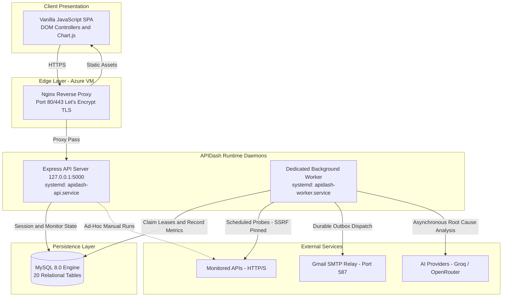
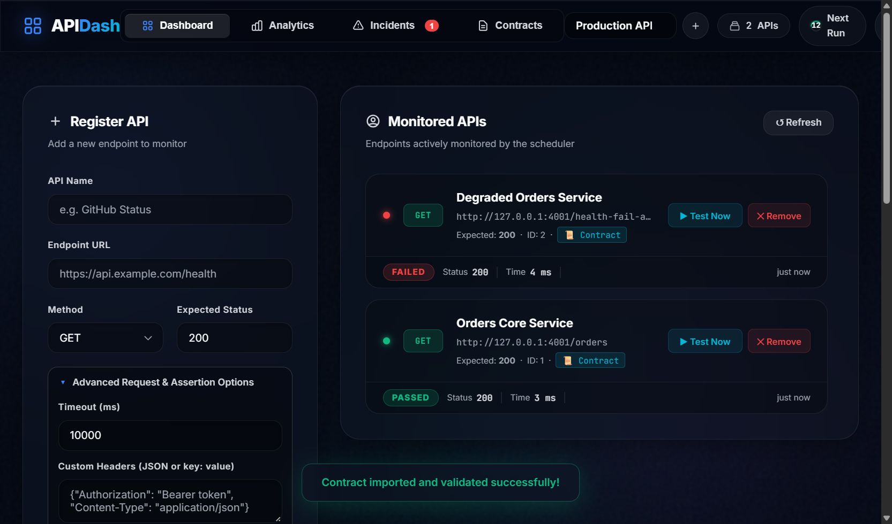
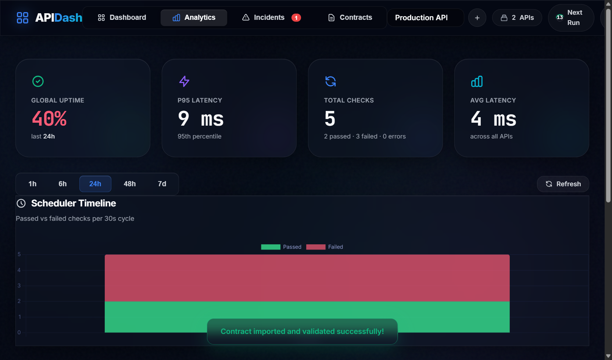
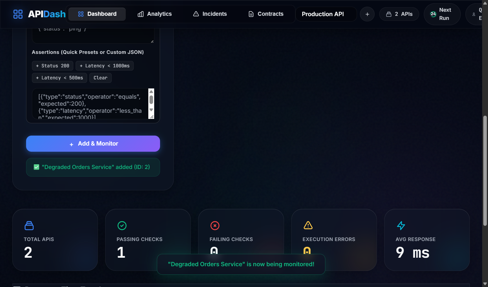
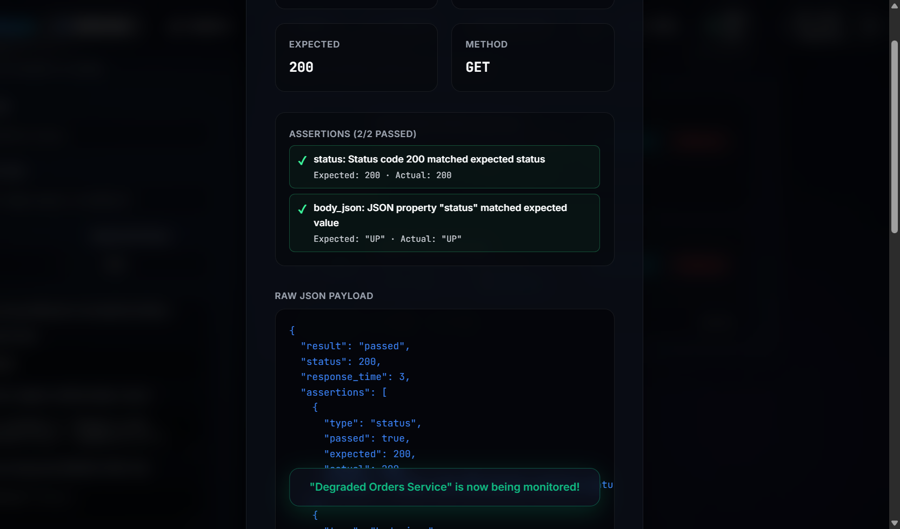
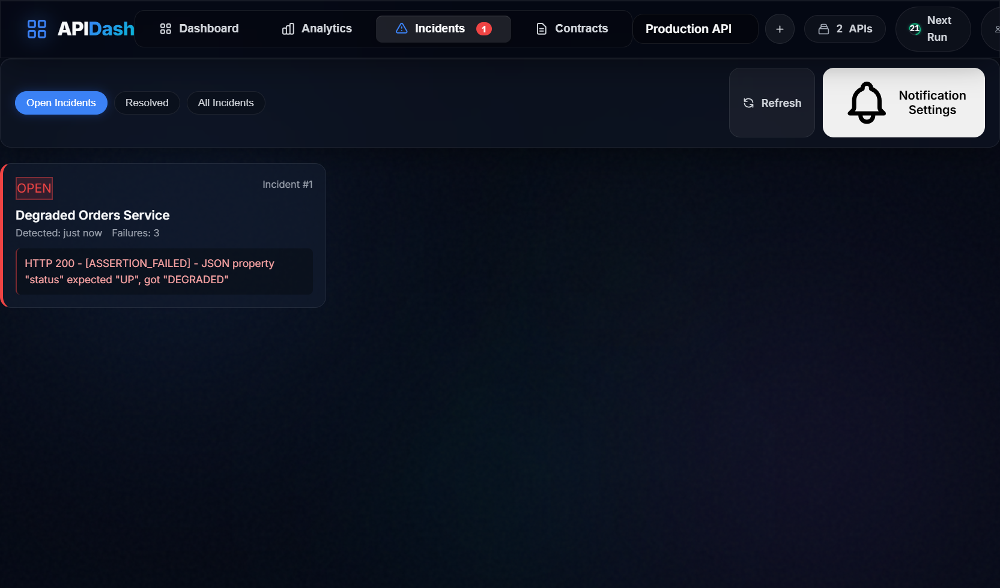
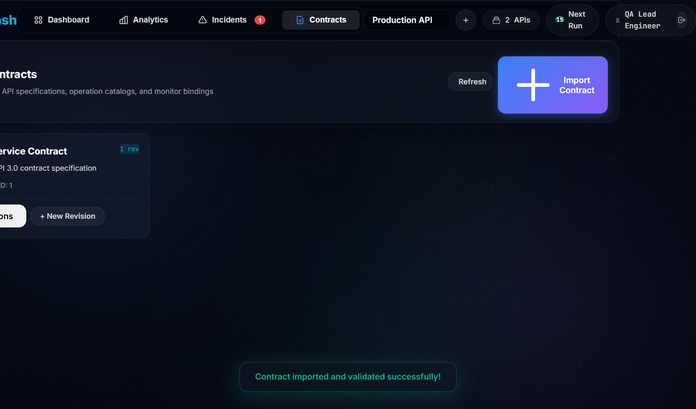
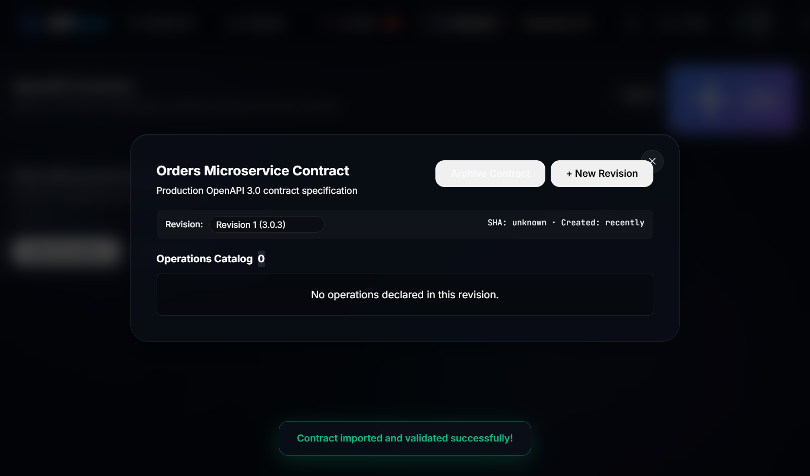
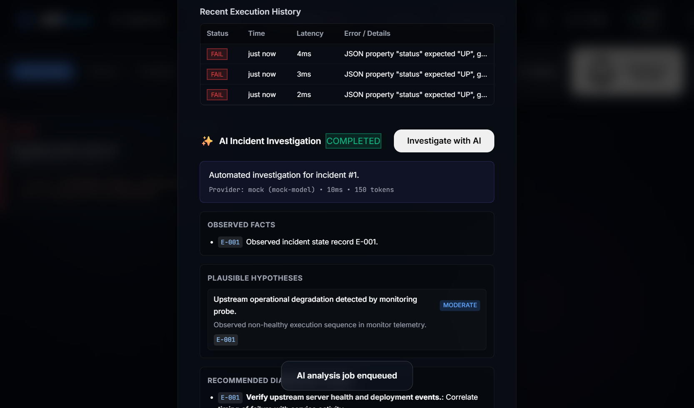

# ⚡ APIDash — Unified Contract-Driven API Testing & Observability Platform

[](https://nodejs.org/)
[](https://expressjs.com/)
[](https://www.mysql.com/)
[](docs/architecture/testing-architecture.md)
[](https://apidash-7f29a6.centralindia.cloudapp.azure.com)
[](https://letsencrypt.org/)
[](LICENSE)

> **A contract-driven, continuous API testing and observability platform that combines deterministic multi-rule health probes, OpenAPI schema drift validation, dual-threshold incident state machines, durable outbox notifications, and grounded AI root cause analysis.**

---

## 🌐 Live Production Deployment

APIDash is deployed to a hardened Microsoft Azure production environment in Central India:

* **Production URL:** [https://apidash-7f29a6.centralindia.cloudapp.azure.com](https://apidash-7f29a6.centralindia.cloudapp.azure.com)
* **TLS Security:** Let's Encrypt Authority X1 (TLS 1.3 / HSTS Preloaded)
* **Infrastructure Topology:** Azure Virtual Machine (`Standard_B2ls_v2`, Ubuntu Server 24.04 LTS) running Nginx reverse proxy, dual systemd daemons, and local MySQL 8.0.

> [!NOTE]
> **Cloud Cost Optimization Policy:**
> To eliminate unnecessary cloud compute charges during non-demonstration intervals, the Azure VM instance is deallocated (`az vm deallocate`) when idle. When starting the VM, all systemd services (`mysql`, `nginx`, `apidash-api`, `apidash-worker`) automatically bootstrap and resume operations with full state persistence.

---

## 📌 Why APIDash?

Traditional uptime checkers only answer a binary question: *"Did the HTTP port respond?"*
They frequently miss critical production failures:
- **Silent Degradation:** An endpoint returns HTTP `200 OK`, but the payload is an empty object or error string.
- **Contract Schema Drift:** A microservice deploys breaking payload modifications (renamed fields, altered types, missing required arrays) without updating API consumers.
- **Flapping Network Noise:** A momentary 1-second packet drop wakes an on-call engineer at 3 AM with false-positive alerts.
- **Alert Storms:** A failed service emits hundreds of repeated alert emails for every failed polling cycle.

**APIDash solves these challenges by combining deterministic health probing with real-time OpenAPI contract validation and stateful incident lifecycles.**

---

## 🏛️ System Architecture



---

## 📸 Curated Screenshot Showcase

| Visual Capability | Dashboard Interface Preview |
| :--- | :--- |
| **System Overview & Health**<br/>Real-time monitor status, global health index, failure streaks, and recent execution timelines. |  |
| **Telemetry & SLA Analytics**<br/>Latency percentiles ($p_{50}, p_{90}, p_{99}$), uptime donut charts, and hourly traffic distribution via Chart.js. |  |
| **Active Monitor Catalog**<br/>Configured endpoints, target methods, polling frequencies, and instant test execution controls. |  |
| **Deterministic Assertion Testing**<br/>Detailed run feedback displaying status codes, roundtrip latencies, response headers, and assertion evaluation diffs. |  |
| **Dual-Threshold Incidents**<br/>Stateful incident view tracking failures, resolution states, and duration timelines with zero flapping noise. |  |
| **OpenAPI Contracts Catalog**<br/>Master repository of imported OpenAPI 3.0/3.1 specifications with versioned revision histories. |  |
| **Contract Operations Explorer**<br/>Interactive endpoint navigator inspecting paths, methods, request bodies, and response JSON Schemas. |  |
| **Grounded AI Root Cause Analysis**<br/>Asynchronous investigation citing verifiable evidence tags (`[E1], [E2]...`) to diagnose production outages. |  |

---

## ✨ Core Features & Capabilities

### 1. Robust Health Probes & Multi-Rule Assertions
- Probes endpoints via `GET`, `POST`, `PUT`, `PATCH`, `DELETE`, `HEAD`, `OPTIONS`.
- Evaluates multi-rule assertions targeting HTTP status codes, latency thresholds, response headers, and dot-notation JSON body properties.
- Bounded payload inspection: safely inspects up to 64 KB in-memory; truncates oversized bodies to defend against memory exhaustion attacks.

### 2. Enterprise Egress Security (SSRF & DNS Pinning)
- Comprehensive SSRF validation blocks private IPv4 (`10.0.0.0/8`, `172.16.0.0/12`, `192.168.0.0/16`), loopback (`127.0.0.0/8`, `::1`), link-local (`169.254.0.0/16`), cloud metadata (`169.254.169.254`), and CGNAT (`100.64.0.0/10`).
- **Custom Socket Agent:** Pins the TCP socket directly to the pre-validated IP address, eliminating Time-of-Check to Time-of-Use (TOCTOU) DNS rebinding attacks.

### 3. Dedicated Background Worker & Lease Concurrency
- Decoupled worker process (`worker.js`) prevents heavy network probing from starving HTTP API threads.
- Monotonic leases with `FOR UPDATE SKIP LOCKED` guarantee multi-worker safety without double-probes.
- Automatic crash recovery: orphaned leases expire after 120 seconds and are reclaimed seamlessly.

### 4. Flapping-Resistant Incident Lifecycle
- Enforces an explicit **2-failure-to-open / 2-pass-to-resolve** state machine.
- Transient single-probe packet drops are filtered out before opening an incident.
- Flapping services must prove stability with two consecutive clean passes before an incident resolves.

### 5. Durable Notification Outbox
- Incident notifications are committed transactionally to `notification_outbox`.
- Dispatches formatted HTML alert emails via Gmail SMTP Relay with exponential retry backoff.
- **Workspace Recipient Security:** Strict validation prevents members from registering arbitrary external emails, blocking open-relay abuse.

### 6. OpenAPI 3.0/3.1 Contract Validation & Drift Detection
- Ingests raw JSON and YAML specifications via the `@scalar/openapi-parser`.
- Compiles response schemas using AJV and `ajv-formats`.
- Flags contract drift instantly when APIs emit unexpected payload types or omit required properties.

### 7. Grounded AI Incident Investigation (Optional)
- Out-of-band asynchronous worker packages telemetry into evidence snapshots (`[E1], [E2]...`).
- Queries LLMs (Groq / OpenRouter) with strict JSON schema enforcement.
- Mandatory citation verification programmatically rejects speculative hallucinations.
- *Disabled by default* (`AI_PROVIDER=disabled`) to preserve 100% deterministic baseline monitoring.

---

## 🚀 Quickstart & Local Development

### Prerequisites
* **Node.js:** v18.0.0 or higher (v20+ LTS recommended)
* **MySQL:** 8.0+
* **npm:** v9+

### 1. Clone Repository
```bash
git clone https://github.com/ritesh0w0/api-health-monitor.git
cd api-health-monitor
```

### 2. Install Dependencies
```bash
cd backend
npm install
```

### 3. Configure Local Environment
Create `backend/.env`:
```env
PORT=5000
NODE_ENV=development
DB_HOST=127.0.0.1
DB_PORT=3306
DB_NAME=apidash
DB_USER=root
DB_PASSWORD=your_local_password
SESSION_SECRET=dev_session_secret_32_characters_minimum
AI_PROVIDER=disabled
```

### 4. Run Database Migrations
Apply all 31 sequential schema migrations:
```bash
node scripts/migrate.js
```

### 5. Launch Application
In two separate terminals:

```bash
# Terminal 1: Launch API Server
cd backend
node server.js
```

```bash
# Terminal 2: Launch Dedicated Background Worker
cd backend
node worker.js
```

Open [http://localhost:5000](http://localhost:5000) in your web browser.

---

## 🧪 Automated Testing Suite

The repository includes **250 automated tests** covering unit logic, integration endpoints, concurrency leases, and synthetic benchmarks:

```bash
cd backend
npm test
```

### Test Coverage Highlights
* **Unit Tests:** Assertion engine, SSRF IP parsing, Scalar OpenAPI parsing, Zod schemas.
* **Integration Tests:** Authentication lifecycle, multi-tenant workspace isolation, contract binding.
* **Concurrency Tests:** Multi-worker schedule leases, outbox delivery contention, crash recovery.
* **Synthetic Benchmark:** 40 realistic failure scenarios evaluating AI hypothesis accuracy.

---

## 📚 Deep-Dive Technical Documentation

For complete architectural specifications, system diagrams, and implementation details, visit the **[Architecture Documentation Suite](docs/architecture/README.md)**:

* [01. System Context & Trust Boundaries](docs/architecture/system-context.md)
* [02. Application Architecture & Monolith Design](docs/architecture/application-architecture.md)
* [03. Deployment Architecture & Azure Infrastructure](docs/architecture/deployment-architecture.md)
* [04. Engineering Methodology & Operational Lifecycle](docs/architecture/methodology.md)
* [05. Backend Components & Source Code Layout](docs/architecture/backend-components.md)
* [06. API Execution Engine & SSRF Protection](docs/architecture/api-execution.md)
* [07. Worker & Distributed Scheduler](docs/architecture/worker-scheduler.md)
* [08. Incident Lifecycle & Flapping Protection](docs/architecture/incident-lifecycle.md)
* [09. Notification System & Durable Outbox](docs/architecture/notification-system.md)
* [10. OpenAPI Contracts & Drift Detection](docs/architecture/openapi-contracts.md)
* [11. AI Incident Investigation Subsystem](docs/architecture/ai-investigation.md)
* [12. Security Architecture & Threat Defense](docs/architecture/security.md)
* [13. Database Architecture & Schema Design](docs/architecture/database-design.md)
* [14. Frontend Architecture & UI Engine](docs/architecture/frontend-architecture.md)
* [15. Testing Architecture & Verification Suite](docs/architecture/testing-architecture.md)

---

## ⚖️ Project Scope & Boundaries

To preserve architectural integrity and operational clarity:
1. **API Server & Worker Process Separation:** The background worker (`worker.js`) is decoupled from `server.js` and must never be merged into the web process.
2. **Deferred API Comparator:** The differential API comparator feature was formally deferred from this release and is not implemented.
3. **AI Disabled by Default:** Deterministic monitoring, alerting, and contract validation operate autonomously without third-party AI dependencies.
4. **Lean Infrastructure:** APIDash operates natively on bare metal / standard Linux VMs via systemd and Nginx without unnecessary Kubernetes or Docker complexity.

---

## 📄 License & Credits

Developed by **Ritesh K** as an academic capstone and enterprise-grade API quality assurance platform.  
Released under the [MIT License](LICENSE).
