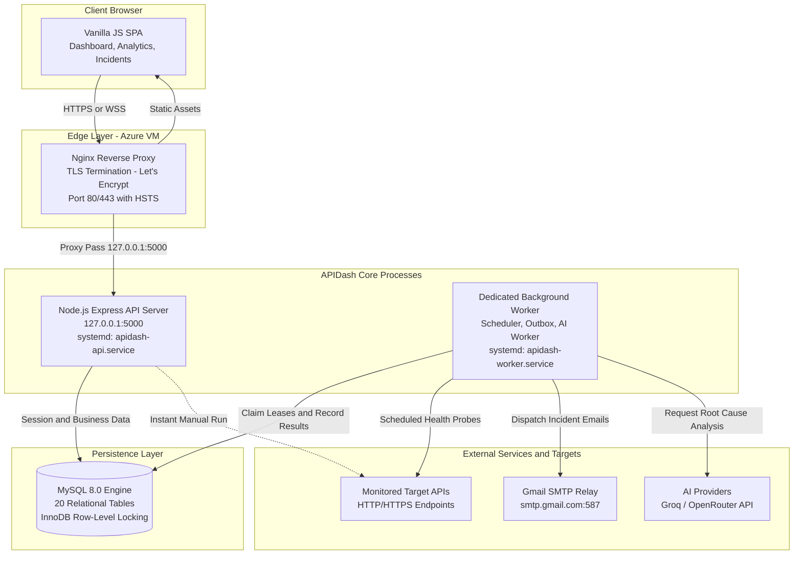

# APIDash Architecture & Technical Specification Suite

Welcome to the definitive architecture documentation for **APIDash** — a Unified Contract-Driven API Testing and Observability Platform designed for continuous API quality assurance.

This documentation suite provides a deep, component-level architectural breakdown of the platform, tracing every layer from HTTP ingestion and background worker scheduling to database durability, contract validation, and AI-assisted root cause analysis.

---

## 🗺️ Documentation Index

| Document | Focus Area | Key Architectural Concepts Covered |
| :--- | :--- | :--- |
| **[01. System Context](system-context.md)** | Ecosystem & Boundaries | External actors, monitored target APIs, cloud providers, AI/SMTP integrations, trust boundaries. |
| **[02. Application Architecture](application-architecture.md)** | Core Structure | Modular monolithic architecture, process decoupling (API vs Worker), state management, shared database layer. |
| **[03. Deployment Architecture](deployment-architecture.md)** | Infrastructure & Hosting | Azure VM topology, Nginx reverse proxy, Let's Encrypt TLS, systemd daemon management, cloud cost deallocation strategy. |
| **[04. Engineering Methodology](methodology.md)** | System Life Cycle | End-to-end operational pipeline: Input → Configuration → Scheduled Probe → Canonical Outcome → Outbox → Resolution. |
| **[05. Backend Components](backend-components.md)** | Modular Decomposition | Express application factory, routing architecture, service layer, data repositories, dependency injection, and clean boundaries. |
| **[06. API Execution & Probing Engine](api-execution.md)** | Health Probes & Security | Axios probe pipeline, SSRF defense, IP pinning, custom socket agent, DNS rebinding mitigation, multi-rule assertion engine. |
| **[07. Worker & Distributed Scheduler](worker-scheduler.md)** | Background Processing | Dedicated worker process, lease-based locking, multi-worker safety, fixed-cadence execution, crash recovery, graceful shutdown. |
| **[08. Incident Lifecycle](incident-lifecycle.md)** | Failure Management | Dual-threshold state machine (2 consecutive failures to open, 2 consecutive passes to resolve), deduplication, timeline tracking. |
| **[09. Notification System](notification-system.md)** | Outbox & Alerting | Durable outbox pattern, workspace member authorization, SMTP transport via Gmail, exponential backoff, rate limiting. |
| **[10. OpenAPI Contracts](openapi-contracts.md)** | Contract Quality Assurance | Scalar OpenAPI parser, AJV JSON Schema compilation, endpoint binding, contract drift detection, historical revision tree. |
| **[11. AI Incident Investigation](ai-investigation.md)** | Root Cause Analysis | Asynchronous investigation worker, provider abstraction (Groq & OpenRouter), fallback orchestrator, evidence citation grounding. |
| **[12. Security Architecture](security.md)** | Threat Modeling & Defense | Argon2id password hashing, HTTP-only SameSite sessions, double-submit CSRF, SSRF firewall, workspace IDOR defense. |
| **[13. Database Design](database-design.md)** | Data Layer | Complete 20-table relational schema, migration lifecycle (1-31), foreign key constraints, indexes, connection pooling. |
| **[14. Frontend Architecture](frontend-architecture.md)** | Client-Side SPA | Vanilla JavaScript architecture, DOM state controllers, Chart.js analytics engine, modal workflows, zero-framework design. |
| **[15. Testing Architecture](testing-architecture.md)** | Quality Assurance | 250 automated tests, unit suites, end-to-end integration tests, multi-worker concurrency tests, synthetic AI benchmark. |
| **[16. Visual Architecture & Methodology](system-architecture-and-methodology.md)** | Comprehensive Diagrams | Full end-to-end 5-tier system topology diagram and 9-phase closed-loop operational methodology flowchart. |

---

## 🏛️ High-Level System Architecture

---

## 📌 Architectural Tenets

1. **Deterministic Quality First:** API monitoring and contract validation are 100% deterministic, governed by RFC-compliant HTTP semantics and strict AJV schema validation.
2. **Strict Process Separation:** The web API server (`server.js`) and background daemon (`worker.js`) are decoupled operating system processes. Heavy probing, alerting, and AI analysis never starve client HTTP threads.
3. **Defense-in-Depth:** Every layer enforces defensive programming — SSRF socket pinning, multi-tenant IDOR checks, CSRF validation, and strict database transactions.
4. **Resilient Outbox & Leases:** All asynchronous side effects (email alerts, AI analyses) are transactionally recorded in durable database outboxes with monotonic leases, preventing duplicate executions and lost messages.
5. **Zero Vendor Lock-In:** Standard Node.js, standard MySQL, vanilla DOM manipulation, and raw systemd daemons on Linux ensure effortless portability across cloud providers.

