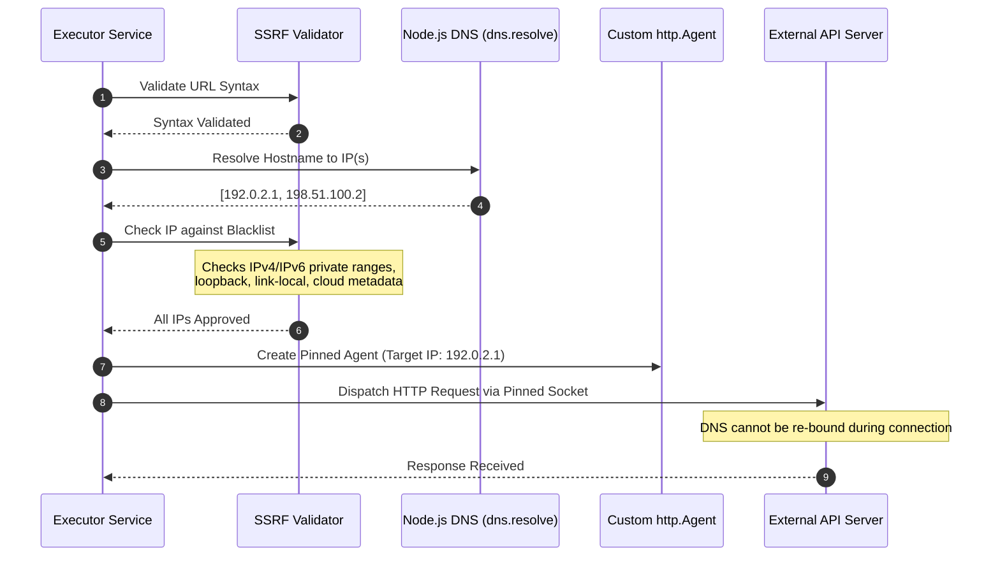

# 06. API Execution & Probing Engine

The API Execution Engine is responsible for safely and deterministically probing external HTTP endpoints, capturing precise network metrics, and evaluating response payloads against defined assertions.

---

## 🔒 SSRF Protection & Socket Pinning Pipeline

Allowing users to specify arbitrary URLs to be fetched by a cloud server introduces the risk of **Server-Side Request Forgery (SSRF)**. Malicious actors could target cloud metadata services (`169.254.169.254`), internal cluster services, or private databases on `10.0.0.0/8`.

APIDash employs a multi-tiered, socket-level defense:



### 1. Blacklisted Address Ranges
The validator in `backend/services/ssrfProtection.js` strictly blocks:
* **IPv4 Private & Loopback:** `127.0.0.0/8`, `10.0.0.0/8`, `172.16.0.0/12`, `192.168.0.0/16`.
* **Link-Local & Cloud Metadata:** `169.254.0.0/16` (including Azure/AWS Instance Metadata Service at `169.254.169.254`).
* **Carrier-Grade NAT (CGNAT):** `100.64.0.0/10`.
* **IPv6 Equivalents:** `::1` (Loopback), `fe80::/10` (Link-local), `fc00::/7` (Unique local), and IPv4-mapped IPv6 addresses (`::ffff:127.0.0.1`).

### 2. Time-of-Check to Time-of-Use (TOCTOU) Defense: Socket Pinning
Traditional SSRF filters resolve an IP, check it, and then hand the URL back to a standard HTTP client. Attackers defeat this using **DNS Rebinding**: their DNS server returns a benign public IP on the first query, and `127.0.0.1` on the second query when the HTTP client connects.

APIDash eliminates this vulnerability by passing a custom `http.Agent` / `https.Agent` with an overridden `createConnection` method. The socket connects directly to the pre-validated IP address while preserving the original `Host` header for virtual hosting and SNI:
```javascript
// Socket pinning prevents DNS rebinding
const agent = new http.Agent({
  lookup: (hostname, options, callback) => {
    callback(null, validatedIpAddress, ipFamily);
  }
});
```

---

## ⚡ Network Probing & Metrics

Network probes are executed via Axios with explicit resource limits:
* **Connection & Response Timeout:** Configurable per monitor (default 10,000 ms, maximum 30,000 ms).
* **Payload Inspection Threshold:** Payloads up to **64 KB** are inspected in-memory. Larger bodies are safely truncated to protect Node.js heap memory from denial-of-service via massive payloads.
* **Timing Breakdown:** High-resolution timers (`process.hrtime.bigint()`) measure total round-trip latency with sub-millisecond precision.

---

## 🧪 Deterministic Assertion Engine

The assertion engine (`backend/services/assertionEngine.js`) evaluates an array of configured assertions against the response:

| Assertion Type | Property Target | Supported Operators | Example Configuration |
| :--- | :--- | :--- | :--- |
| **Status Code** | `statusCode` | `equals`, `notEquals`, `in` | `{"type": "status", "operator": "equals", "value": 200}` |
| **Response Time** | `responseTime` | `lessThan`, `greaterThan` | `{"type": "latency", "operator": "lessThan", "value": 500}` |
| **HTTP Header** | `headers.<header_name>` | `exists`, `equals`, `contains` | `{"type": "header", "property": "content-type", "operator": "contains", "value": "application/json"}` |
| **JSON Body Path** | `body.<dot.path>` | `exists`, `equals`, `notEquals` | `{"type": "body", "property": "data.user.id", "operator": "exists"}` |

### Prototype Pollution Defense
When evaluating nested JSON body expressions (e.g., `body.a.b.c`), paths containing dangerous prototype identifiers (`__proto__`, `constructor`, `prototype`) are rejected strictly before resolution, preventing object prototype manipulation.
