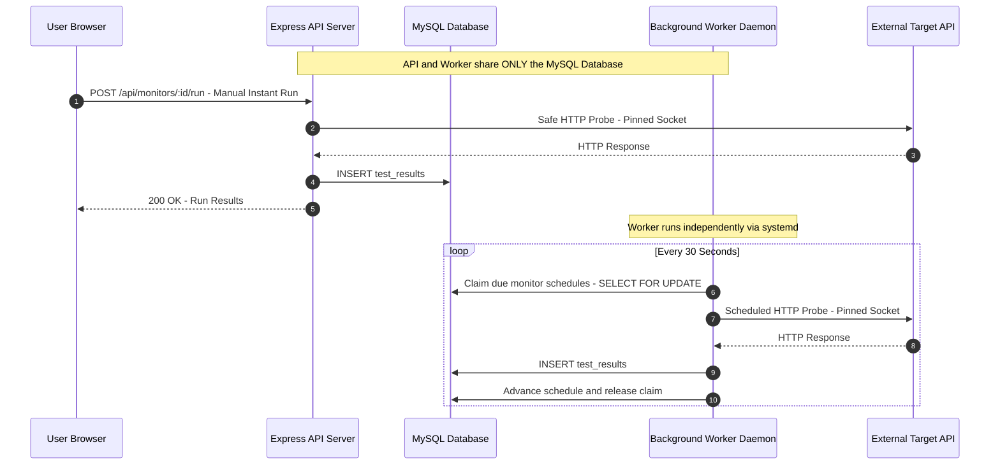

# 02. Application Architecture

APIDash is architectured as a **Modular Monolith** with decoupled runtime execution processes. This design delivers the simplicity, transactional consistency, and straightforward deployment of a monolith while preserving the resilience, isolation, and scalability characteristics of distributed services.

---

## 🏛️ Component Decomposition

```mermaid
graph TB
    subgraph ClientTier ["Presentation Tier - Browser"]
        SPA["Vanilla JavaScript SPA<br/>DOM Controllers, Chart.js, Modals"]
    end

    subgraph APITier ["Web and API Tier - Process 1"]
        Server["Express App Factory - app.js"]
        AuthRouter["Auth Router - /api/auth"]
        WorkspaceRouter["Workspace Router - /api/workspaces"]
        MonitorRouter["Monitor Router - /api/monitors"]
        ContractRouter["Contract Router - /api/contracts"]
        IncidentRouter["Incident Router - /api/incidents"]
        AnalyticsRouter["Analytics Router - /api/analytics"]
    end

    subgraph ServiceTier ["Core Domain Services"]
        CoordService["Monitoring Coordinator"]
        ExecService["Probe Executor - Axios and Pinning"]
        AssertService["Assertion Engine"]
        ContractService["Contract Validation Service - AJV"]
        IncService["Incident Service - State Machine"]
        OutboxService["Notification Outbox Service"]
    end

    subgraph WorkerTier ["Background Processing Tier - Process 2"]
        WorkerProc["Worker Daemon - worker.js"]
        SchedLoop["Scheduler Loop - 30s Cadence"]
        OutboxLoop["Notification Dispatcher Loop - 1s Loop"]
        AILoop["AI Investigation Worker - 2s Loop"]
    end

    subgraph PersistenceTier ["Persistence Tier - MySQL 8.0"]
        DB[(MySQL Database)]
        Sessions[("sessions")]
        Users[("users and workspaces")]
        Monitors[("api_monitors and schedules")]
        Results[("test_results and metrics")]
        Incidents[("incidents and events")]
        Outbox[("notification_outbox")]
        AIJobs[("incident_ai_analyses")]
    end

    SPA -->|RESTful Calls + Cookie| Server
    Server --> AuthRouter
    Server --> WorkspaceRouter
    Server --> MonitorRouter
    Server --> ContractRouter
    Server --> IncidentRouter
    Server --> AnalyticsRouter

    MonitorRouter --> CoordService
    CoordService --> ExecService
    ExecService --> AssertService
    ExecService --> ContractService
    CoordService --> IncService

    WorkerProc --> SchedLoop
    WorkerProc --> OutboxLoop
    WorkerProc --> AILoop
    SchedLoop --> CoordService
    OutboxLoop --> OutboxService

    AuthRouter --> Users
    AuthRouter --> Sessions
    WorkspaceRouter --> Users
    MonitorRouter --> Monitors
    SchedLoop --> Monitors
    CoordService --> Results
    IncService --> Incidents
    IncService --> Outbox
    AILoop --> AIJobs
```

---

## ⚙️ Process Separation: API Server vs. Background Worker

A fundamental architectural constraint of APIDash is that the **API server process** (`server.js`) and the **Worker daemon process** (`worker.js`) run as separate operating system processes.

### Why Decouple API and Worker?
1. **Thread Pool Protection:** Probing slow or unresponsive external endpoints consumes Node.js sockets, HTTP connection pools, and memory. Offloading scheduled runs to a dedicated worker prevents event loop starvation in the user-facing web server.
2. **Independent Failure Domains:** A memory spike or uncaught fatal exception during a third-party API probe or large OpenAPI contract parse will not crash the user-facing web dashboard.
3. **Dedicated Resource Scaling:** Background loops execute at configurable intervals without interfering with HTTP latency or concurrency limits.

---

## 📦 Domain Service Layer

The application logic is decoupled from HTTP transport. All business rules reside in dedicated domain service singletons:

1. **`monitoringCoordinator.js`**: Orchestrates the full lifecycle of an API run: executes the network probe, validates assertions, checks OpenAPI contracts, updates incident state machines, and writes analytical metrics.
2. **`executor.js`**: Low-level HTTP execution engine. Performs DNS pre-resolution, validates target IP addresses against SSRF blacklists, pins the TCP socket to the validated IP, and issues the request.
3. **`assertionEngine.js`**: High-performance assertion validator. Evaluates status codes, response latencies, HTTP headers, and nested JSON body expressions with prototype pollution protection.
4. **`contractValidatorService.js`**: Ingests OpenAPI 3.0/3.1 specifications via Scalar, compiles response JSON Schemas with AJV, and verifies production payload compliance.
5. **`incidentService.js`**: Enforces a strict dual-threshold state machine: transitions a monitor to `OPEN` after 2 consecutive failures and marks it `RESOLVED` after 2 consecutive passes.
6. **`notificationDispatcher.js`**: Polls the `notification_outbox` table, renders HTML alert templates, and delivers emails via Nodemailer with exponential backoff.
7. **`aiAnalysisWorker.js`**: Background consumer for `incident_ai_analyses`. Packages sanitized diagnostic telemetry and queries configured LLM providers (Groq primary: `openai/gpt-oss-20b`, OpenRouter fallback gateway: `nvidia/nemotron-3.5-lightning:free`) for structured root cause insights.

---

## 🔒 Shared Database Concurrency & Leases

Because both the API server and Worker daemon interact with the same database, concurrency control is enforced through **atomic row-level leases** and **InnoDB transactions**:

* **Worker Leases:** When the worker claims due monitors or pending notification jobs, it uses `NOW()`-based lease tokens and update timestamps. If a worker node crashes mid-execution, orphaned jobs automatically expire and are reclaimed by the next loop iteration.
* **Idempotency:** Test result insertion generates immutable historical records (`test_results`). Downstream updates to monitor rollups (`api_monitors.last_status`, `consecutive_failures`) occur inside the same database transaction.

