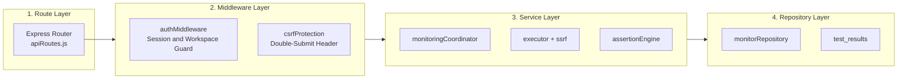

# 05. Backend Components & Directory Structure

The APIDash backend is structured around a modular, layered design with explicit separation of concerns: Transport (Routes/Middleware) → Domain Logic (Services) → Persistence (Repositories/Database).

---

## 📂 Source Code Layout

```
backend/
├── ai/                         # AI provider adapters and prompt templates
│   ├── evaluation/             # Ground truth datasets & evaluation harness
│   ├── fallbackAiProvider.js   # Dual-provider fallback orchestrator
│   ├── groqAiProvider.js       # Groq API provider adapter
│   ├── mockAiProvider.js       # Deterministic mock provider for CI testing
│   ├── openrouterAiProvider.js # OpenRouter API provider adapter
│   └── promptTemplates.js      # Grounded diagnostic prompt builders
├── config.js                   # Zod-validated environment configuration
├── data/                       # Data Access Layer (Repositories)
│   ├── analyticsRepository.js  # Telemetry rollups, uptime & percentile queries
│   ├── contractRepository.js   # OpenAPI schemas, revisions & bindings
│   ├── incidentAiRepository.js # AI investigation jobs & persistence
│   ├── incidentRepository.js   # Incident state machine persistence & logs
│   ├── monitorRepository.js    # API monitor CRUD & schedules
│   ├── notificationRepository.js # Notification settings & outbox queue
│   ├── userRepository.js       # User identity & authentication queries
│   └── workspaceRepository.js  # Multi-tenant workspace memberships & roles
├── db.js                       # MySQL connection pool & transaction helpers
├── logger.js                   # Pino structured JSON logger
├── middleware/                 # Express middleware
│   ├── authMiddleware.js       # Session authentication & workspace IDOR guards
│   ├── csrfProtection.js       # Double-submit cookie CSRF validation
│   └── errorHandler.js         # Centralized error handler & status mapping
├── migrations/                 # Sequential SQL migration files (001 - 031)
├── routes/                     # HTTP Route Handlers
│   ├── analyticsRoutes.js      # /api/analytics endpoints
│   ├── apiRoutes.js            # /api/monitors endpoints (CRUD & execution)
│   ├── authRoutes.js           # /api/auth endpoints (register, login, logout)
│   ├── contractRoutes.js       # /api/contracts endpoints (import, bind, drift)
│   ├── incidentRoutes.js       # /api/incidents endpoints (lifecycle & AI)
│   └── workspaceRoutes.js      # /api/workspaces endpoints (members & settings)
├── scripts/                    # CLI utilities & migration runner
├── services/                   # Core Business Logic Layer
│   ├── aiAnalysisWorker.js     # Background worker for AI investigation jobs
│   ├── aiProviderService.js    # AI provider factory & singleton manager
│   ├── aiResponseValidator.js  # JSON Schema validator for LLM output
│   ├── assertionEngine.js      # Rule-based response assertion evaluation
│   ├── contractValidatorService.js # Scalar + AJV contract compliance
│   ├── emailService.js         # Nodemailer SMTP transport abstraction
│   ├── executor.js             # Low-level HTTP probe execution & socket pinning
│   ├── incidentEvidenceBuilder.js # Diagnostic package synthesizer
│   ├── incidentService.js      # Incident detection & state transitions
│   ├── monitoringCoordinator.js # End-to-end monitor execution pipeline
│   ├── notificationDispatcher.js # Durable outbox email delivery daemon
│   ├── openapiParserService.js # Scalar OpenAPI 3.0/3.1 document parser
│   ├── passwordService.js      # Argon2id hashing & verification
│   ├── schedulerWorker.js      # Background monitor scheduler daemon
│   └── ssrfProtection.js       # DNS resolution & IP address validation
├── test/                       # Comprehensive test suites (250 tests)
├── app.js                      # Express application factory (createApp)
├── server.js                   # HTTP web server entrypoint (binds port 5000)
└── worker.js                   # Background daemon entrypoint (scheduler + outbox)
```

---

## 🏭 Application Factory: `createApp()` vs. `server.js`

To guarantee 100% testability and prevent port conflicts during integration testing, the Express setup is split:

* **`app.js` (`createApp(options)`):**
  * Configures middleware: JSON body parser, URL-encoded parser, cookie parser, and Pino request logging.
  * Mounts static frontend assets with caching headers.
  * Injects routes with pluggable middleware overrides (e.g., injecting a mock CSRF handler during testing).
  * Returns an un-bound Express application instance suitable for `supertest`.
* **`server.js`:**
  * Imports `createApp()`.
  * Loads environment variables from `config.js`.
  * Verifies database connectivity.
  * Binds to `PORT` (default 5000) on `127.0.0.1`.
  * Registers graceful shutdown handlers for `SIGINT` and `SIGTERM`.

---

## 🛡️ Layered Architecture & Data Flow


    Domain --> Persistence
```

### Dependency Injection & Mockability
Domain services accept repository dependencies or connection pools via function arguments or constructor parameters, allowing unit and integration tests to replace real database operations with fast in-memory stubs or transaction-isolated test fixtures.

