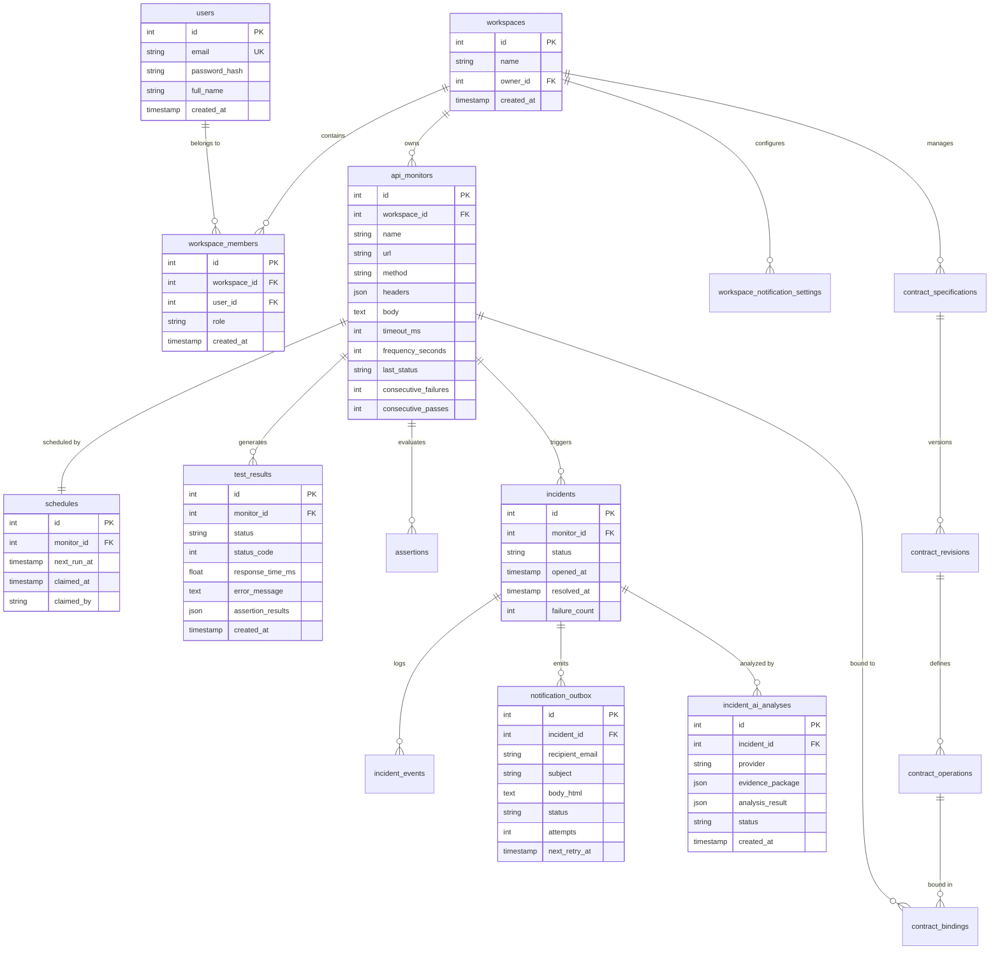

# 13. Database Architecture & Schema Design

APIDash utilizes **MySQL 8.0** with the **InnoDB storage engine**, leveraging ACID transactions, row-level locking, foreign key integrity, and optimized b-tree indexing.

---

## 🗄️ Complete Entity-Relationship (ER) Model

---

## 📋 The 20 Relational Tables Catalog

1. **`users`**: User identities, Argon2id password hashes, and registration timestamps.
2. **`workspaces`**: Multi-tenant workspace entities and primary ownership.
3. **`workspace_members`**: Workspace membership associations with roles (`OWNER`, `MEMBER`).
4. **`workspace_notification_settings`**: Alert toggles (`notify_on_open`, `notify_on_resolve`) and authorized recipient list.
5. **`api_monitors`**: Monitor definitions (URL, method, headers, frequency, timeouts, status rollups).
6. **`schedules`**: Dedicated scheduling ledger with lease tokens (`claimed_at`, `claimed_by`, `next_run_at`).
7. **`assertions`**: Deterministic assertion rules (status, latency, headers, body path expressions).
8. **`test_results`**: Immutable time-series ledger of all completed probe runs.
9. **`incidents`**: High-level incident state tracking (`OPEN`, `RESOLVED`, duration, failure count).
10. **`incident_events`**: Audit log of discrete incident lifecycle events (`OPENED`, `RESOLVED`, `ANALYSIS_ATTACHED`).
11. **`notification_outbox`**: Transactional email queue with delivery status, retry counters, and backoff timestamps.
12. **`contract_specifications`**: Master catalog of imported OpenAPI specifications.
13. **`contract_revisions`**: Versioned history of OpenAPI schemas (raw JSON/YAML and dereferenced AST).
14. **`contract_operations`**: Granular operational endpoints extracted from specifications.
15. **`contract_bindings`**: Associations binding specific API monitors to contract operations.
16. **`contract_drift_logs`**: Historical log of schema mismatch violations and validation failures.
17. **`incident_ai_analyses`**: Asynchronous AI investigation jobs, evidence packages, and structured LLM results.
18. **`sessions`**: Server-side user session store managed by `express-mysql-session`.
19. **`system_audit_logs`**: Administrative audit trail for security-critical workspace mutations.
20. **`schema_migrations`**: Migration ledger tracking applied migrations and execution timestamps.

---

## 🔄 Sequential Migration Lifecycle (Migrations 001 - 031)

Database schema evolution is strictly version-controlled via sequential migration files in `backend/migrations/`:
* `001_initial_schema.sql` through `005_...`: Core tables (users, workspaces, monitors, test_results).
* `006_...` through `012_...`: Dedicated worker schedules and lease columns.
* `013_...` through `018_...`: Incident lifecycle state machine and event logs.
* `019_...` through `024_...`: Notification outbox and workspace recipient settings.
* `025_...` through `028_...`: OpenAPI specification ingestion, operations, and AJV bindings.
* `029_...` through `031_...`: AI incident investigation jobs and diagnostic evidence schemas.

Migrations execute idempotently using a transactional runner (`backend/scripts/migrate.js`) that locks `schema_migrations` before applying pending DDL scripts.

