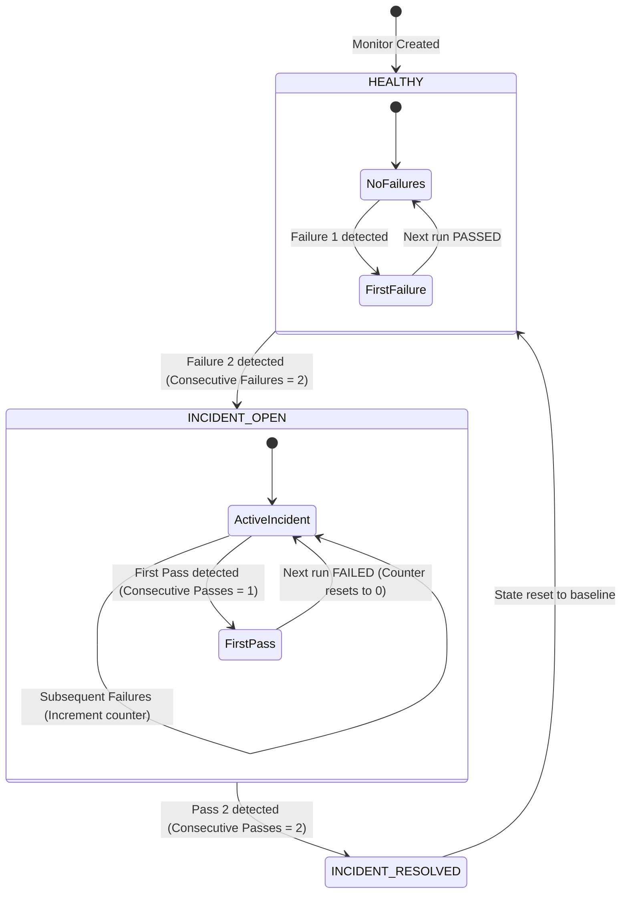

# 08. Incident Lifecycle & Flapping Protection

To maintain high alert fidelity and prevent notification fatigue caused by transient network glitches, APIDash implements a stateful **dual-threshold incident lifecycle**.

---

## 🚦 Dual-Threshold Incident State Machine

A single dropped packet or momentary network timeout must not awaken an on-call engineer. Similarly, a single successful probe does not prove an unhealthy service has truly recovered.

APIDash enforces an explicit **2-failure-to-open / 2-pass-to-resolve** state machine:

---

## 📊 State Transitions & Decision Matrix

| Current Incident State | Probe Result | Consecutive Counter | New Incident State | Side-Effects Generated |
| :--- | :--- | :--- | :--- | :--- |
| `NONE` / `RESOLVED` | `FAILED` / `ERROR` | Failures: 1, Passes: 0 | `NONE` (Flapping Buffer) | None. Telemetry recorded in `test_results`. |
| `NONE` / `RESOLVED` | `FAILED` / `ERROR` | Failures: 2, Passes: 0 | `OPEN` | **Incident Opened.** Row inserted into `incidents`. Outbox alert queued. AI investigation queued. |
| `OPEN` | `FAILED` / `ERROR` | Failures: $N+1$, Passes: 0 | `OPEN` | Telemetry updated. No redundant email alerts sent. |
| `OPEN` | `PASSED` | Failures: 0, Passes: 1 | `OPEN` (Flapping Buffer) | Incident remains `OPEN`. Consecutive passes incremented to 1. |
| `OPEN` | `PASSED` | Failures: 0, Passes: 2 | `RESOLVED` | **Incident Resolved.** Incident marked `RESOLVED`. Outbox resolution email queued. |

---

## 🛡️ Anti-Flapping & Deduplication Guarantees

1. **Alert Deduplication:**
   When an incident transitions to `OPEN`, an initial notification is queued in `notification_outbox`. While the incident remains `OPEN`, subsequent failed runs increment the incident's `failure_count` and log historical telemetry, but **do not** emit additional emails.
2. **Transient Glitch Suppression:**
   If a probe fails due to a momentary DNS hiccup but immediately passes on the next scheduled run, the consecutive failure count resets to zero. An incident is never created, and no alerts are dispatched.
3. **Recovery Verification:**
   Services experiencing intermittent flapping (e.g., oscillating between 200 OK and 500 Server Error) will not repeatedly close and reopen incidents. The incident remains `OPEN` until the service demonstrates two consecutive clean passes.

---

## 📜 Incident Evidence & Event History

Every incident maintains an immutable audit log in `incident_events`:
* **`OPENED`:** Captures opening HTTP status, failed assertion details, and error messages.
* **`ANALYSIS_ATTACHED`:** Records the completion of an asynchronous AI root cause analysis.
* **`RESOLVED`:** Records the exact timestamp, recovery latency, and passing assertion response that confirmed service restoration.
