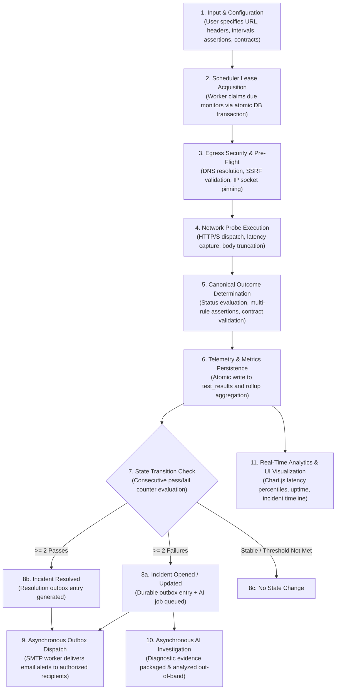

# 04. Engineering Methodology & Operational Lifecycle

APIDash governs API quality through an end-to-end, multi-stage operational lifecycle. This methodology bridges deterministic network testing, real-time contract validation, stateful incident tracking, durable notifications, and AI-assisted root cause analysis into a continuous observability feedback loop.

---

## 🔄 End-to-End Operational Pipeline

---

## 📑 Detailed Stage Breakdown

### Stage 1: Input & Configuration
* **Monitors:** Defined per workspace with HTTP method (`GET`, `POST`, `PUT`, `DELETE`, etc.), target endpoint, request headers, query parameters, request payload, timeout (up to 30,000 ms), and polling frequency (e.g., 30s, 60s, 300s).
* **Deterministic Assertions:** Configured as JSON rules targeting HTTP status codes (`equals`, `in`), response latency (`lessThan`), response headers (`exists`, `equals`), and JSON body properties (dot-notation path evaluation).
* **OpenAPI Binding:** Monitors can be bound to specific operations (`operationId` or `METHOD /path`) defined in an uploaded OpenAPI 3.0/3.1 document.

### Stage 2: Scheduler Lease Acquisition
* Background worker executes a lease acquisition query every 30 seconds.
* Due monitors are claimed with a monotonic lease timestamp (`claimed_at = NOW()`), preventing competing worker threads from executing redundant probes.

### Stage 3: Egress Security & Pre-Flight
* Prior to dispatching network packets, the target URL is parsed.
* The hostname is resolved via system DNS. Every returned IP address is checked against forbidden ranges (private, loopback, link-local, carrier-grade NAT, and cloud metadata).
* A custom Node.js `http.Agent` / `https.Agent` pins the TCP socket directly to the validated IP, eliminating Time-of-Check to Time-of-Use (TOCTOU) DNS rebinding attacks.

### Stage 4: Network Probe Execution
* The probe is dispatched via Axios over the pinned socket.
* High-resolution timers measure DNS lookup, TCP handshake, TLS negotiation, and first-byte response time.
* Large payloads (>64 KB) are safely truncated for in-memory inspection to prevent heap exhaustion.

### Stage 5: Canonical Outcome Determination
The run result is synthesized into one of three canonical outcomes:
1. `PASSED`: HTTP status matches expected code, all configured assertions evaluate to true, and response body satisfies OpenAPI schema (if bound).
2. `FAILED`: Target responded, but an HTTP status assertion failed, a body assertion was violated, or contract schema drift occurred.
3. `ERROR`: Network transport failure, connection timeout, DNS lookup failure, SSL handshake error, or SSRF boundary block.

### Stage 6: Telemetry & Metrics Persistence
* A permanent record is inserted into `test_results` containing the status code, latency (ms), error message, and assertion failure breakdown.
* Rollup statistics in `api_monitors` are updated: `last_status`, `last_run_at`, `consecutive_passes`, and `consecutive_failures`.

### Stage 7 & 8: Incident State Transition
* **2 Consecutive Failures:** Triggers the opening of an `incident` in state `OPEN`. Consecutive passes counter resets to 0.
* **2 Consecutive Passes:** If an incident is active, 2 consecutive successful checks transition the incident to `RESOLVED`.
* Flapping protection ensures transient single-packet drops do not trigger false alerts.

### Stage 9 & 10: Asynchronous Side-Effect Processing
* **Outbox Delivery:** Incident events generate records in `notification_outbox`. The background dispatcher polls these jobs, checks workspace recipient authorizations, and delivers email alerts via SMTP.
* **AI Root Cause Analysis:** If enabled, the failure telemetry is packaged into a redacted diagnostic snapshot and analyzed asynchronously by an LLM worker, providing human-readable hypotheses with cited evidence.

### Stage 11: Real-Time Visualization
* The user interface renders latency percentiles ($p_{50}, p_{90}, p_{99}$), uptime ratios, incident timelines, and contract validation status in responsive Chart.js widgets.
