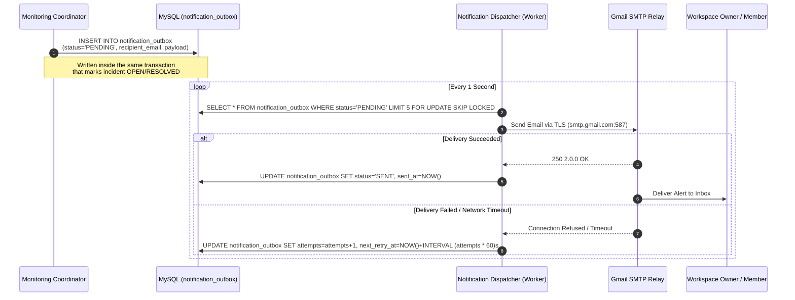
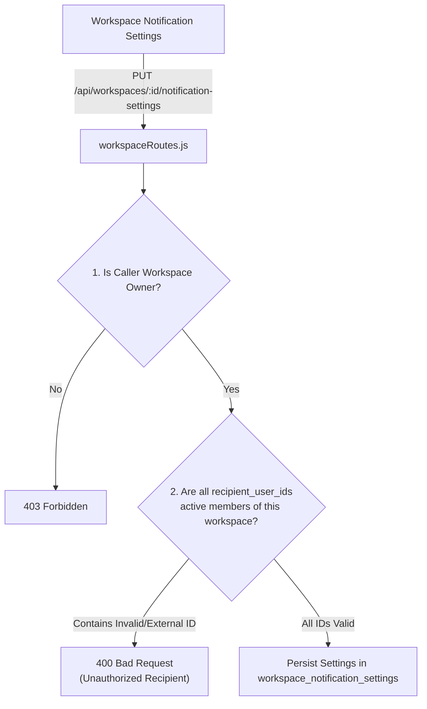

# 09. Notification System & Durable Outbox

The APIDash notification subsystem is responsible for delivering timely, reliable incident alerts to authorized workspace stakeholders without blocking HTTP operations or dropping messages during transport outages.

---

## 📬 The Durable Outbox Pattern

To guarantee that email notifications are never lost if the email delivery service or network experiences temporary downtime, APIDash implements the **Durable Outbox Pattern**:

### Outbox Reliability Principles
1. **Transactional Insertion:** Outbox entries are inserted in the exact same database transaction as the incident state change. If the transaction rolls back, no ghost notification is sent; if it commits, the notification is guaranteed to be in the queue.
2. **Exponential Backoff:** If the SMTP server returns an error or times out, the message enters exponential retry intervals ($1 \times 60\text{s}$, $2 \times 60\text{s}$, $4 \times 60\text{s}$, etc.) up to a maximum of 5 attempts before being flagged `FAILED`.
3. **Graceful Degradation:** If SMTP credentials are not configured in the environment (`SMTP_USER` is empty), the outbox marks items `SKIPPED` and surfaces a warning banner in the dashboard without failing the monitoring run.

---

## 👥 Authorized Recipient Security & Workspace Isolation

To prevent workspace users from entering arbitrary external email addresses (which could turn the platform into an open email relay or spam proxy), notifications can **only** be routed to verified members of that workspace.

### The Numeric User ID Architecture & Hardening
During production integration, an issue was resolved where frontend checkbox serialization converted undefined membership fields into `NaN`, serializing to `[null]` in JSON and triggering a Zod schema validation error (`recipient_user_ids.0: Invalid input: expected number, received null`).

The fix hardened both ends of the pipeline:
* **Repository Alignment:** `workspaceRepository.findMembers` explicitly aliases `u.id AS id, wm.user_id`, guaranteeing a numeric identifier across all object representations.
* **Frontend Strict Parsing:** `frontend/app.js` extracts `Number(m.user_id ?? m.id)` and filters against `Number.isInteger(id) && id > 0`, explicitly rejecting `null`, `undefined`, or `0`.
* **Backend Zod Schema:** Strictly validates `recipient_user_ids` as `z.array(z.number().int().positive())`.

---

## ✉️ SMTP Configuration & Transport

In the production deployment, emails are delivered through a dedicated Google Workspace SMTP Relay:

* **Host:** `smtp.gmail.com`
* **Port:** `587` (STARTTLS)
* **Authentication:** App Password authentication (`ryyf lzwa xurh yatx`) associated with `apidash.alerts@gmail.com`.
* **Security:** Enforces opportunistic TLS 1.3 encryption during transport.
