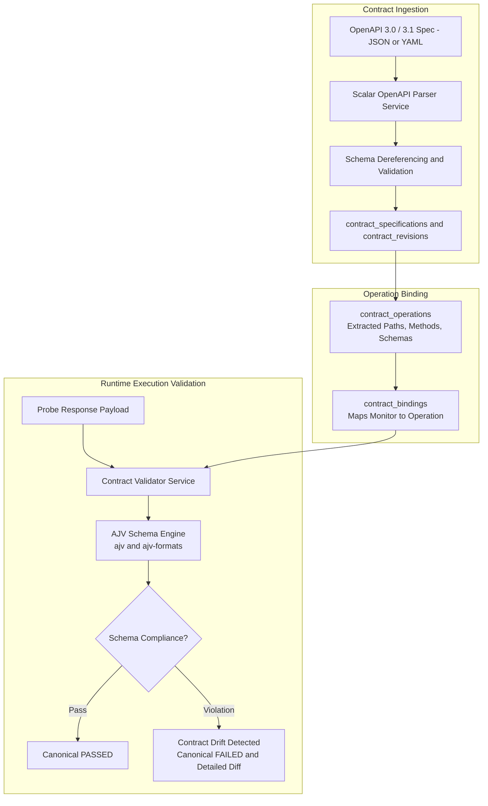

# 10. OpenAPI Contracts & Drift Detection

APIDash elevates conventional HTTP monitoring into **Contract-Driven Quality Assurance**. Instead of solely verifying status codes, APIDash validates production API responses against formal OpenAPI specifications, catching schema violations, breaking payload changes, and missing fields before they impact consumers.

---

## 📐 Architecture of the Contract Subsystem



---

## 🔍 Ingestion & Parsing: The Scalar Engine

APIDash leverages `@scalar/openapi-parser` for specification parsing:
* **Format Flexibility:** Natively ingests raw JSON and YAML definitions.
* **Specification Support:** Handles both OpenAPI `3.0.x` and OpenAPI `3.1.x` (including full JSON Schema draft-2020-12 alignment).
* **Reference Dereferencing:** Resolves local `$ref` pointers (e.g., `#/components/schemas/UserProfile`) to build self-contained operational schemas.
* **Operation Cataloging:** Automatically extracts and catalogs all available HTTP operations, generating clean operation IDs, descriptions, and path parameters.

---

## 🧪 Real-Time Validation: AJV Engine

When an API monitor is bound to a contract operation:

1. **Schema Retrieval:** Upon receiving the HTTP response, the coordinator fetches the compiled response schema matching the returned HTTP status code (or `default` fallback).
2. **AJV Compilation:** The schema is validated using `ajv` configured with `allErrors: true`, `coerceTypes: false`, and `ajv-formats` (validating `date-time`, `email`, `uri`, `uuid`, etc.).
3. **Drift Detection:**
   * **Missing Required Fields:** If a contract specifies `required: ["id", "email"]` and the production API omits `email`, AJV flags an immediate schema violation.
   * **Type Mismatch:** If an ID changes from an `integer` to a `string`, it is flagged as a breaking contract drift.
   * **Enum Violations:** Unannounced additions or modifications to enum fields are caught instantly.

```json
{
  "contract_drift": true,
  "errors": [
    {
      "keyword": "required",
      "dataPath": "/data",
      "schemaPath": "#/properties/data/required",
      "message": "must have required property 'created_at'"
    }
  ]
}
```

---

## 📜 Revision Tracking & Immutability

Contracts are versioned via the `contract_revisions` table:
* Updating an OpenAPI document creates an incremental revision (`v1`, `v2`, etc.).
* Monitors maintain an explicit binding to either the latest active revision or a pinned historical version.
* Drift reports highlight historical deviations, providing engineering teams with concrete evidence when third-party microservices silently deploy breaking changes.

