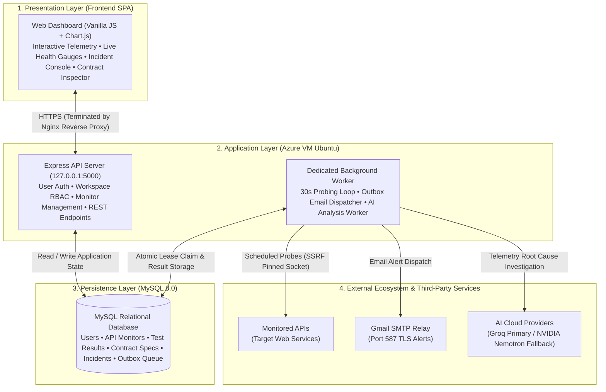
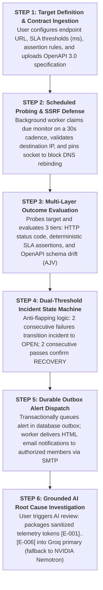

# APIDash — System Architecture & Methodology (Presentation & Report Edition)

> **College Presentation & Report Summary:**  
> This document contains simplified, high-impact diagrams designed specifically for **project reports (fits on a single page in Word)** and **PowerPoint slides (clean, readable on projectors)**, accompanied by concise viva-defense talking points.

---

## 🏛️ 1. System Architecture Diagram

### 🎤 1-Minute Presentation Script (System Architecture)
> *"Examiners, our system architecture is organized into four clean layers:*
> 1. * **Presentation Layer:** A zero-framework Vanilla JavaScript Single Page Application that renders real-time telemetry and latency distributions using Chart.js without heavyweight framework overhead.*
> 2. * **Application Layer:** Deployed on an Azure Ubuntu VM using Nginx as an edge reverse proxy. Crucially, we enforce strict **process separation**: the user-facing Express API server and the background worker daemon run as separate operating system processes, ensuring scheduled background network probes never freeze the user interface.*
> 3. * **Persistence Layer:** A local MySQL 8.0 database storing monitors, time-series test results, OpenAPI contracts, and durable outbox queues with InnoDB row-level locking.*
> 4. * **External Ecosystem:** The worker dispatches secure, SSRF-defended probes to target APIs, triggers real-time email alerts via Gmail SMTP relay, and orchestrates dual-provider AI root cause analysis using Groq as primary and NVIDIA Nemotron via OpenRouter as fallback."*

---

## 🔄 2. Operational Methodology Diagram

### 🎤 1-Minute Presentation Script (Methodology)
> *"Our engineering methodology follows an automated, 6-step closed-loop quality assurance pipeline:*
> 1. * **Configure:** The developer specifies the target endpoint, SLA latency limit, multi-rule assertions, and optionally binds it to an OpenAPI contract.*
> 2. * **Secure Probe:** Every 30 seconds, the background worker executes a probe. Before sending packets, it runs an SSRF defense check to block private IP access and pins the socket to prevent DNS rebinding.*
> 3. * **Evaluate:** The response is evaluated across three tiers: status code, deterministic assertions, and contract schema compliance (catching silent schema drift).*
> 4. * **State Machine:** To prevent false alarms from network hiccups (flapping), our incident state machine requires **two consecutive failures** to open an incident, and **two consecutive passes** to mark it resolved.*
> 5. * **Alert Dispatch:** State changes write an entry to a durable database outbox, where the dispatcher safely relays email alerts to verified workspace members.*
> 6. * **AI Root Cause Analysis:** If the developer needs fast troubleshooting, a single click packages redacted failure evidence into our dual-provider AI engine (Groq primary, NVIDIA Nemotron fallback) to produce evidence-grounded hypotheses with zero hallucinations."*

---

## 📊 Summary Table for Report Inclusion

| Architectural Dimension | Implementation in APIDash | Primary Benefit |
| :--- | :--- | :--- |
| **System Pattern** | Modular Monolith with Process Decoupling | High performance, zero microservice complexity, isolated failure domains. |
| **Edge Security** | Nginx Reverse Proxy with TLS 1.3 & HSTS | Secure HTTPS termination and automated Let's Encrypt certificate renewal. |
| **Network Egress Defense** | Custom Agent Socket IP Pinning | Total immunity against SSRF and Time-of-Check Time-of-Use DNS rebinding. |
| **Contract Quality** | OpenAPI 3.0/3.1 validation via Scalar + AJV | Catches unexpected breaking payload mutations before downstream users do. |
| **Incident Stability** | Dual-threshold state machine (2-fail / 2-pass) | Completely eliminates false alarms and alerting noise from transient network blips. |
| **Alerting Reliability** | Transactional Outbox Pattern | Guarantees zero lost alerts during server restarts or transient SMTP outages. |
| **AI Investigation** | Dual-Provider Fallback (Groq + OpenRouter/Nemotron) | High speed (~1.7s Groq) with seamless fallback if rate-limited, strictly cited. |
