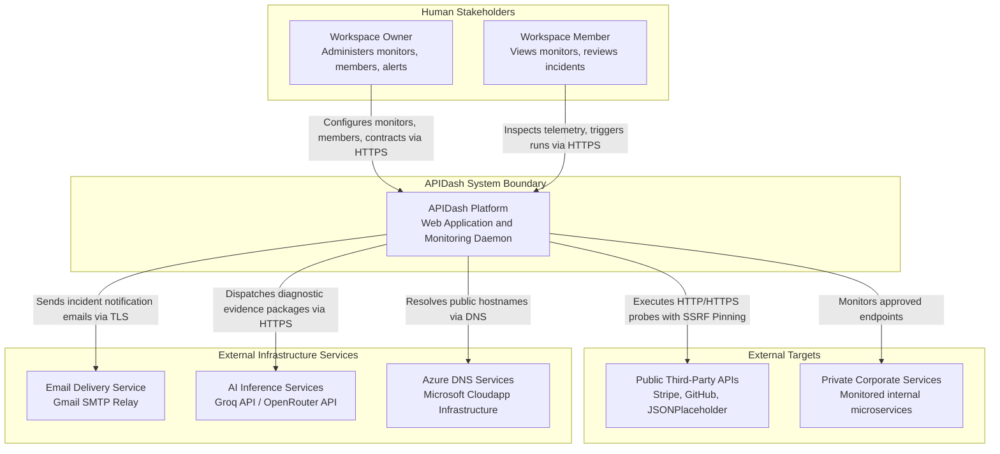
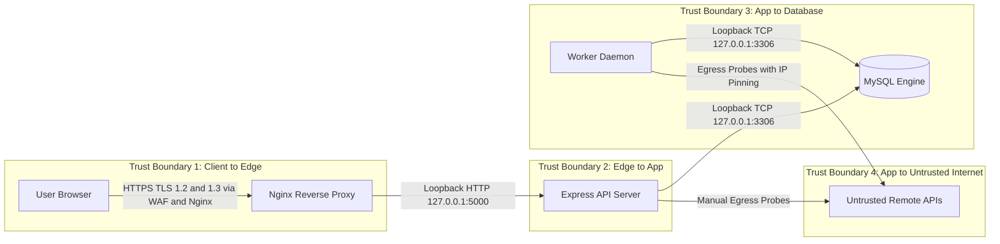

# 01. System Context & Trust Boundaries

The **System Context** view defines the high-level boundary of the APIDash platform, identifying how human actors, third-party systems, and external services interact across defined security perimeters.

---

## 🌐 Context Diagram (C4 Level 1)

---

## 👥 Actor Roles & Permissions

APIDash enforces a strict role-based access control (RBAC) model within a multi-tenant workspace architecture.

| Actor Role | Authentication Mechanism | Permissions & Responsibilities |
| :--- | :--- | :--- |
| **Workspace Owner** | Argon2id hashed password + Session Cookie | Full administrative authority. Can create, edit, and delete monitors; invite and revoke members; update workspace notification recipients; import OpenAPI contracts; and trigger manual runs. |
| **Workspace Member** | Argon2id hashed password + Session Cookie | Read-and-execute authority. Can view all monitors, contracts, analytics, and incident reports within assigned workspaces; trigger ad-hoc manual runs; and request AI incident analyses. Cannot delete monitors or modify member permissions. |
| **Anonymous / Guest** | None (Unauthenticated) | Can only access the public landing page, registration form, and login endpoint. All API routes reject anonymous requests with `401 Unauthorized`. |

---

## 🛡️ Trust Boundaries & Attack Surfaces

The platform establishes four distinct trust boundaries:

### 1. Client-to-Edge Boundary
* **Channel:** Public Internet over HTTPS (TCP 443).
* **Protections:**
  * Strict Let's Encrypt TLS certificate termination on Nginx.
  * HTTP Strict Transport Security (HSTS) with a 1-year max-age (`preload`).
  * Security headers: `X-Frame-Options: SAMEORIGIN`, `X-Content-Type-Options: nosniff`, `Content-Security-Policy`.
  * Double-submit CSRF tokens required on state-mutating requests (`POST`, `PUT`, `DELETE`).

### 2. Edge-to-App Boundary
* **Channel:** Local loopback interface (`127.0.0.1:5000`).
* **Protections:**
  * Express server does not bind to external network adapters (`0.0.0.0`); it binds strictly to `127.0.0.1`.
  * Public requests cannot bypass Nginx to reach the Node.js process directly.
  * Reverse proxy headers (`X-Forwarded-For`, `X-Forwarded-Proto`) are sanitized and validated.

### 3. Application-to-Data Boundary
* **Channel:** Local loopback interface (`127.0.0.1:3306`).
* **Protections:**
  * MySQL server binds strictly to `127.0.0.1`.
  * Dedicated application user with minimal required grants (no `FILE`, `GRANT OPTION`, or `SUPER` privileges).
  * Parameterized SQL queries using `mysql2/promise` prepared statements, preventing SQL injection.

### 4. Application-to-Untrusted-Internet Boundary (Egress)
* **Channel:** Outbound HTTP/HTTPS requests originating from the Monitoring Engine.
* **Protections:**
  * **Server-Side Request Forgery (SSRF) Defense:** Custom agent validates DNS resolution before connection.
  * Rejects private IP ranges (`10.0.0.0/8`, `172.16.0.0/12`, `192.168.0.0/16`), loopback (`127.0.0.0/8`, `::1`), link-local (`169.254.0.0/16`), and cloud metadata services (`169.254.169.254`).
  * **Socket Pinning:** Connection socket is pinned directly to the pre-validated IP address, eliminating DNS rebinding attacks (Time-of-Check to Time-of-Use race conditions).

