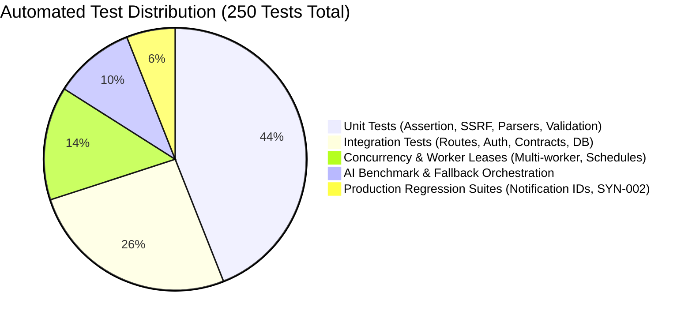

# 15. Testing Architecture & Verification Suite

Quality assurance in APIDash is enforced through a comprehensive, multi-tiered automated test suite comprising **250 automated tests** executed using Node.js's native test runner (`node --test`).

---

## 🏗️ Testing Pyramid & Test Distribution



---

## 🧪 Test Suite Architecture & File Catalog

The test suite resides in `backend/test/` and encompasses 43 specialized test files:

### 1. Security & Core Engine Tests
* **`ssrf.test.js`**: Validates IP blacklisting, IPv4/IPv6 private ranges, CGNAT, link-local, cloud metadata blocks, and DNS rebinding socket pinning.
* **`assertionEngine.test.js`**: Tests status, latency, header, and JSON body assertions, payload truncation (>64 KB), and prototype pollution rejection.
* **`auth.test.js` & `csrf.test.js`**: Verifies Argon2id password hashing, session lifecycle, and double-submit CSRF cookie/header matching.
* **`workspaceAuth.test.js`**: Validates multi-tenant isolation, cross-tenant IDOR defense, and role permissions (`OWNER` vs `MEMBER`).

### 2. Monitoring & Worker Concurrency Tests
* **`executor.test.js` & `coordinator.test.js`**: Tests end-to-end HTTP probing, response timing, and canonical outcome synthesis.
* **`schedulerClaim.test.js` & `multiWorkerIntegration.test.js`**: Tests atomic `FOR UPDATE SKIP LOCKED` lease claiming, multi-worker concurrency, and race condition prevention.
* **`workerLifecycle.test.js` & `schedulerDurability.test.js`**: Verifies graceful shutdown, active probe draining, and crash recovery of orphaned leases.

### 3. Incidents & Notifications
* **`incidentLifecycle.test.js` & `incidentConcurrency.test.js`**: Tests the 2-failure-to-open and 2-pass-to-resolve state machine, flapping prevention, and audit logging.
* **`notificationDispatch.test.js`**: Validates the durable outbox pattern, retry backoff intervals, and SMTP error handling.
* **`notificationSettingsRegression.test.js`**: 11-case regression suite verifying numeric user ID resolution, owner/member selection, unauthorized recipient rejection, and settings persistence.

### 4. OpenAPI Contract Validation
* **`openapiParser.test.js`**: Ingests OpenAPI 3.0/3.1 JSON and YAML specifications via Scalar and validates dereferenced AST output.
* **`contractValidation.test.js` & `contractIntegration.test.js`**: Tests AJV response schema validation, enum violations, missing required properties, and drift detection.

### 5. AI Investigation & Synthetic Benchmarks
* **`aiFallback.test.js` & `aiProvider.test.js`**: Tests primary/fallback failover under 429 rate limits, 5xx errors, timeouts, and circuit breaker fast-path skips.
* **`aiResponseValidator.test.js`**: Validates strict JSON schema enforcement and rejects hallucinated evidence citation tags.
* **`syntheticDataset.test.js` & `evaluatorRubric.test.js`**: Executes a 40-scenario synthetic failure benchmark evaluating root cause hypothesis precision and evidence citation fidelity.

---

## 🚀 Test Execution & Verification

Tests are executed locally without requiring live external network access by utilizing in-memory Express instances and local database fixtures:

```bash
cd backend
npm test
```

### Typical Verification Output
```text
✔ Phase 7 — AI Investigation Endpoints, Authorization, and IDOR Defense (11873ms)
✔ Phase 7 — Worker Lifecycle, Leasing, Processing, and Staleness Detection (4170ms)
✔ Multi-Worker Concurrency — Prevents double-claim on simultaneous polls (85ms)
✔ Notification Settings Regression — Enforces valid numeric user IDs and workspace auth (45ms)
✔ SSRF Defense — Pinned socket agent guarantees connection to validated IP (3ms)
ℹ tests 250
ℹ suites 0
ℹ pass 250
ℹ fail 0
ℹ cancelled 0
ℹ skipped 0
ℹ duration_ms 55004
```
