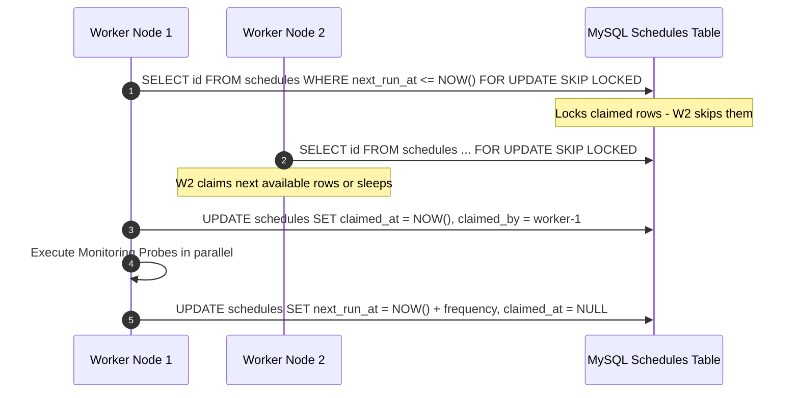
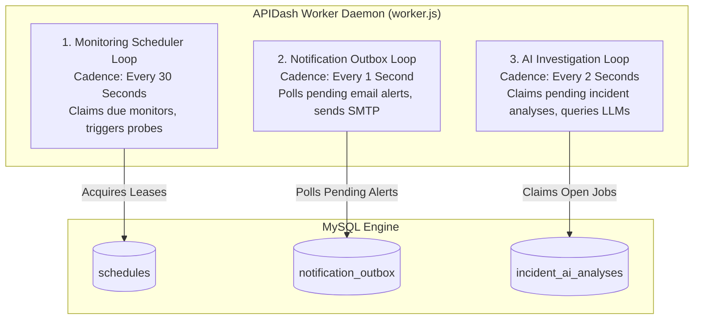
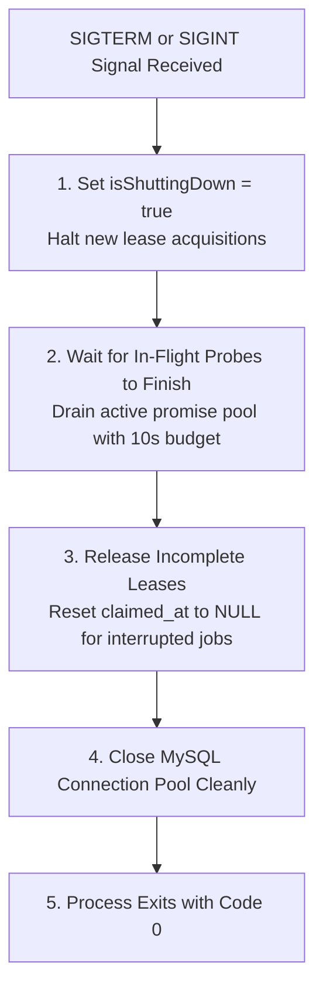

# 07. Worker & Distributed Scheduler Architecture

The APIDash background worker (`backend/worker.js`) is an independent daemon process responsible for executing scheduled monitoring runs, dispatching notification outbox items, and executing out-of-band AI incident analyses.

---

## 🔄 Concurrency Model & Lease Architecture

In multi-instance or high-availability deployments, multiple worker processes may run concurrently. To prevent race conditions, duplicate probes, or competing notifications, APIDash implements a **monotonic lease acquisition protocol** backed by MySQL row-level locking.

### 1. `FOR UPDATE SKIP LOCKED`
Worker threads execute transactional queries using `FOR UPDATE SKIP LOCKED`. If Node 1 is currently processing a batch of monitor schedules, Node 2 does not block waiting for the locks to release; it immediately claims the next available unlocked rows or safely sleeps.

### 2. Monotonic Leases & Crash Recovery
* When a worker claims a schedule or an outbox notification, it writes a `claimed_at` timestamp and worker identifier token.
* **Lease Timeout (120 seconds):** If a worker process experiences a fatal crash (e.g., node power failure or SIGKILL) mid-run, the row remains locked only until the lease window expires. On the subsequent iteration, any healthy worker detects `claimed_at < NOW() - INTERVAL 120 SECOND` and recovers the orphaned job automatically.

---

## ⏱️ Fixed-Cadence Background Loops

The worker runs three distinct asynchronous event loops, each decoupled by cadence and domain concern:

1. **Scheduler Loop (Every 30 Seconds):**
   * Inspects `schedules` table for rows where `next_run_at <= NOW()`.
   * Acquires leases and invokes `monitoringCoordinator.executeMonitoringRun()`.
   * Recalculates `next_run_at = NOW() + INTERVAL frequency_seconds SECOND` upon completion.
2. **Notification Dispatcher Loop (Every 1 Second):**
   * Polls `notification_outbox` for rows in state `PENDING` with retry attempts `< MAX_RETRIES`.
   * Dispatches emails to authorized workspace recipients via SMTP.
3. **AI Investigation Loop (Every 2 Seconds):**
   * Inspects `incident_ai_analyses` for state `PENDING`.
   * Invokes the configured AI provider to analyze diagnostic evidence out-of-band.

---

## 🛑 Graceful Shutdown Protocol

When the systemd service stops (`systemctl stop apidash-worker`) or receives `SIGTERM` / `SIGINT`:

This sequence prevents data corruption, ensures no network sockets are abruptly dropped, and guarantees that orphaned leases are cleanly released rather than waiting for timeout expiration.

