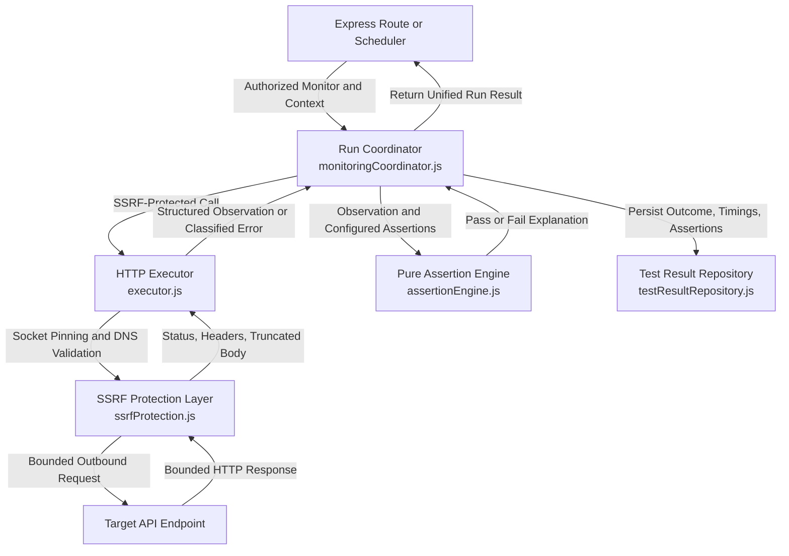

# APIDash Phase 3 — Monitoring Executor and Assertion Engine

## Executive Summary

Phase 3 establishes the core monitoring execution engine for APIDash (`c:\APIDash`). It transforms the initial basic HTTP check into a deterministic, secure, multi-assertion pipeline that enforces strict boundary limits, captures explainable diagnostic evaluations, and cleanly separates execution from assertion evaluation and persistence.

All Phase 2 security assurances—workspace-level tenant isolation, SSRF destination validation, socket IP pinning against DNS rebinding, manual redirect re-validation, and credentials stripping—remain strictly enforced on every monitoring run.

---

## 1. Architecture Before and After

### Prior State (Phase 2)
In Phase 2, `backend/services/tester.js` directly executed an HTTP probe via `safeMonitoringRequest` and immediately compared the status code with `api.expected_status`. Results were binary (`PASS` or `FAIL`), could not evaluate headers or JSON body payloads, lacked fine-grained transport error classification, and bundled execution and evaluation into a single monolithic function.

### Phase 3 Architecture
Phase 3 divides monitoring execution into four distinct, loosely coupled layers:



### Component Responsibilities

1. **Pure Assertion Engine (`backend/services/assertionEngine.js`):**
   - Pure, deterministic evaluation logic with zero database, network, or Express dependencies.
   - Evaluates HTTP status, response latency, response headers, and nested JSON body properties.
   - Strictly validates configuration and guards against prototype pollution attacks.

2. **Controlled HTTP Executor (`backend/services/executor.js`):**
   - Dispatches outbound HTTP requests through `backend/services/ssrfProtection.js`.
   - Enforces server-side resource bounds (30s maximum timeout ceiling, 1MB max response body, 64KB safe body inspection limit).
   - Classifies low-level transport errors (`TIMEOUT`, `DNS_FAILURE`, `TLS_ERROR`, `CONNECTION_REFUSED`, `CONNECTION_RESET`, `SSRF_BLOCKED`, `RESPONSE_TOO_LARGE`, `REDIRECT_ERROR`).
   - Redacts authorization tokens, cookies, and API keys from diagnostic error messages.

3. **Run Coordinator (`backend/services/monitoringCoordinator.js`):**
   - Orchestrates the monitoring lifecycle: resolves monitor, executes request, evaluates assertions, assigns canonical outcome, and coordinates persistence.
   - Evaluates a snapshot of assertions at execution time, guaranteeing that subsequent changes to monitor configuration never retroactively rewrite historical run results.
   - Ensures execution errors are recorded honestly without misrepresenting database persistence failures.

4. **Persistence Layer (`backend/data/apiRepository.js` & `backend/data/testResultRepository.js`):**
   - Stores custom monitor request configurations (`headers`, `body`, `timeout_ms`, `assertions`).
   - Persists structured assertion evaluations and classified error types in `test_results`.

---

## 2. Canonical Run Outcome Semantics

Every monitoring run produces one of three canonical outcomes:

| Outcome | Definition | Unhealthy? | Example |
| :--- | :--- | :---: | :--- |
| **`passed`** | The HTTP request completed successfully and **every** configured assertion passed. | No | Status 200, latency 140ms < 500ms max, JSON `status` equals `"healthy"`. |
| **`failed`** | A usable HTTP response was received, but **one or more assertions failed**. | **Yes** | Server returned HTTP 500 when 200 was expected, or latency 1200ms exceeded 1000ms threshold. |
| **`error`** | The request could not be completed reliably due to a network, transport, DNS, TLS, timeout, or execution error. | **Yes** | Connection timed out, DNS lookup failed, TLS certificate invalid, connection refused, or target blocked by SSRF policy. |

### Critical Unhealthy Semantics
Both `failed` and `error` outcomes are classified as **unhealthy**. In analytics aggregations, uptime calculations, failure streaks, scheduler summaries, and dashboard cards:
- An endpoint with a network timeout (`error`) is treated as down.
- An endpoint returning an unexpected status (`failed`) is treated as down.
- Legacy historical records (`PASS` and `FAIL`) continue to be accurately parsed alongside new records.

---

## 3. Assertion Configuration Contract

Monitors store assertions as a JSON array of assertion objects.

### Validation Bounds
- Maximum assertions per monitor: **20**.
- Configuration must be a valid JSON array of objects.
- Each assertion requires a recognized `type`.

### Supported Assertion Types

#### A. HTTP Status (`type: "status"`)
- **Operator `equals`:** Checks for an exact HTTP status code between 100 and 599.
  ```json
  { "type": "status", "operator": "equals", "expected": 200 }
  ```
  *(Convenience aliases: `{ "type": "status", "equals": 200 }` or `{ "type": "status", "status": 200 }`)*
- **Operator `2xx`:** Checks that the HTTP status code is in the range `[200, 299]`.
  ```json
  { "type": "status", "operator": "2xx", "expected": "2xx" }
  ```

#### B. Response Latency (`type: "latency"`)
- Checks that elapsed execution time in milliseconds does not exceed `max_ms` (1 to 60,000 ms).
  ```json
  { "type": "latency", "max_ms": 1000 }
  ```
  *(Convenience alias: `{ "type": "latency", "expected": 1000 }`)*

#### C. Response Header (`type: "header"`)
- Header name lookup is **case-insensitive**, matching RFC 9110 HTTP semantics.
- Operators supported:
  - `exists`: Verifies header is present.
  - `equals`: Verifies exact string equality (trimmed).
  - `contains`: Verifies substring presence (case-insensitive substring check).
  ```json
  { "type": "header", "name": "content-type", "operator": "contains", "value": "application/json" }
  ```
  *(Convenience alias: `{ "type": "header", "header": "content-type", "contains": "application/json" }`)*

#### D. JSON Body (`type: "body_json"`)
- Traverses parsed JSON response bodies using safe dot-separated property paths (e.g., `data.user.status` or `results.0.id`).
- Operators supported:
  - `exists`: Verifies property exists on object and is not undefined.
  - `equals`: Verifies deep equality with expected JSON primitive, array, or object.
  ```json
  { "type": "body_json", "path": "status", "operator": "equals", "value": "healthy" }
  ```
  *(Convenience alias: `{ "type": "body_json", "path": "status", "equals": "healthy" }`)*

### Prototype Pollution Defense
To prevent prototype pollution attacks via user-supplied paths, `parseAndValidatePropertyPath` in `backend/services/assertionEngine.js` explicitly rejects any path containing:
- `__proto__`
- `prototype`
- `constructor`

Property resolution uses `Object.prototype.hasOwnProperty.call(current, segment)` at every step.

### Default Status Behavior
If a monitor has no explicit assertions configured, the coordinator automatically evaluates a default status assertion expecting `api.expected_status` (or HTTP 2xx if unspecified). A monitor can never pass silently simply because network bytes were exchanged.

---

## 4. Controlled HTTP Executor & SSRF Protection

Outbound requests must pass through `safeMonitoringRequest` in `backend/services/ssrfProtection.js`. The executor applies the following safeguards:

1. **Host Header Pinning:** Requests bind to the DNS-validated IP address and enforce `Host: <hostname>` to prevent virtual host routing confusion.
2. **DNS Rebinding Prevention:** Custom HTTP and HTTPS socket agents pin socket connections directly to the pre-validated IP address.
3. **Redirect Revalidation:** Redirects are handled manually (Axios `maxRedirects: 0`). Each redirect location is parsed, checked against IPv4/IPv6 private/metadata blacklists, and re-validated. Protocol downgrades from HTTPS to HTTP are blocked.
4. **Proxy Disablement:** Explicit `proxy: false` prevents environment variable proxy injection.
5. **Resource Ceilings:**
   - Server-enforced timeout ceiling: minimum 100ms, maximum 30,000ms (user-configured values cannot exceed 30 seconds).
   - Maximum response body limit: 1 MB (1,048,576 bytes) stream truncation.
   - Maximum body inspection limit: 64 KB (65,536 bytes) retained in memory for JSON evaluation.
6. **Error Classification & Diagnostic Redaction:**
   - Transport errors are classified into standard categories (`TIMEOUT`, `DNS_FAILURE`, `TLS_ERROR`, `CONNECTION_REFUSED`, `CONNECTION_RESET`, `SSRF_BLOCKED`, `RESPONSE_TOO_LARGE`, `REDIRECT_ERROR`, `TRANSPORT_ERROR`).
   - Authorization headers (`authorization`, `cookie`, `set-cookie`, `x-api-key`) and credentials in diagnostic messages are stripped and replaced with `[REDACTED]`.

---

## 5. Database Schema Changes & Migrations

Two forward-only migrations were added:

### Migration 009: Enhance APIs Table
File: `backend/migrations/009_enhance_apis_table.sql`
```sql
ALTER TABLE apis
  ADD COLUMN headers TEXT NULL AFTER method,
  ADD COLUMN body TEXT NULL AFTER headers,
  ADD COLUMN timeout_ms INT DEFAULT 10000 AFTER body,
  ADD COLUMN assertions TEXT NULL AFTER timeout_ms;
```

### Migration 010: Enhance Test Results Table
File: `backend/migrations/010_enhance_test_results_table.sql`
```sql
ALTER TABLE test_results
  MODIFY COLUMN result VARCHAR(20) NOT NULL,
  ADD COLUMN assertion_results TEXT NULL AFTER error_message,
  ADD COLUMN error_type VARCHAR(50) NULL AFTER assertion_results;
```

### Migration Execution Command
```bash
npm run db:migrate
```

*Note: MySQL with standard pool settings executes one SQL statement per call. Each migration file contains exactly one `ALTER TABLE` statement, guaranteeing clean forward execution and crash recovery.*

---

## 6. Backward Compatibility & Frontend Integration

### Backward Compatibility
- Existing rows in `test_results` with `PASS` and `FAIL` remain intact and valid.
- `backend/services/analytics.js` aggregates both legacy (`PASS`, `FAIL`) and canonical (`passed`, `failed`, `error`) statuses.
- SQL statistics queries in `apiRepository.js` count `PASS` and `passed` as passing, and `FAIL`, `failed`, and `error` as failing.

### Frontend Enhancements (`frontend/app.js` & `frontend/style.css`)
- **Status Badges & Dots:** Updated card result strips and status indicator dots to support `passed` (green), `failed` (red), and `error` (amber).
- **Test Result Modal:** Displays the test result badge, status code, response time, error classification badge, and an interactive **Assertions Breakdown** list showing each check's pass/fail state, type, expected value, and actual observed value.
- **Latency Chart:** Point markers use `#3dffa0` for passed, `#ff5c77` for failed, and `#ffc84a` for errors, with matching tooltip indicators.

---

## 7. Scope Boundaries & Deferred Features

In accordance with the APIDash roadmap:
- **Phase 4 (Deferred):** Separate background worker processes, Redis queueing, retry policies, and background scheduler redesign.
- **Phase 5 (Deferred):** Incident tracking, threshold alerting, and notification integrations (Email, Slack, Telegram).
- **Phase 6 (Deferred):** OpenAPI specification import and JSON schema contract validation.
- **Phase 7 (Deferred):** AI-generated root cause analysis and diagnosis.
- **Comparator (Deferred):** Multi-environment API response comparison tool.
