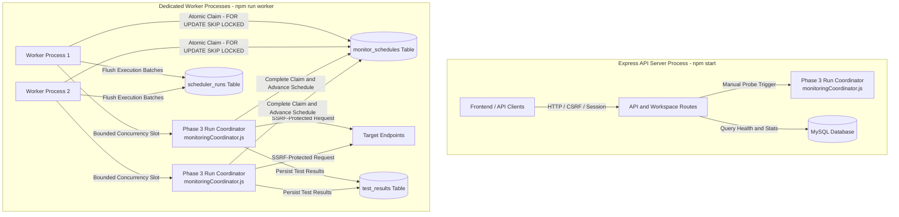

# APIDash Phase 4 — Durable Scheduler, Dedicated Background Worker, and Concurrency Control

## Executive Summary

Phase 4 establishes an enterprise-grade, durable, multi-worker background execution architecture for APIDash (`c:\APIDash`). Scheduled monitoring is completely decoupled from the Express API server and moved into a dedicated background worker process (`backend/worker.js`).

Scheduled executions are durable, crash-resilient, strictly bounded, and race-safe across multiple concurrent worker instances using MySQL 8 row-level locking (`SELECT ... FOR UPDATE SKIP LOCKED`) and short, atomic database transactions.

All Phase 2 workspace authorization and SSRF protections, as well as the Phase 3 unified execution pipeline (`monitoringCoordinator`, `executor`, and `assertionEngine`), are preserved and reused without duplication.

---

## 1. System Architecture



### Separation of Responsibilities

| Responsibility | API Server (`backend/server.js`) | Background Worker (`backend/worker.js`) |
| :--- | :---: | :---: |
| HTTP Request Handling (REST API) | **Yes** | **No** (binds no HTTP port) |
| User Authentication & Sessions | **Yes** | **No** |
| Manual On-Demand Probes (`/api/test/:id`) | **Yes** | **No** |
| Recurring Scheduled Monitor Claiming | **No** (completely retired) | **Yes** |
| Outbound Scheduled HTTP Monitoring | **No** | **Yes** |
| Lease Expiration Recovery | **No** | **Yes** |
| Graceful In-Flight Shutdown Budget | HTTP connections only | Outbound HTTP jobs & leases |

---

## 2. Running the System

### Running the API Server

```bash
cd backend
npm start
# Runs Express on http://localhost:5000 (or configured PORT)
```

### Running the Dedicated Background Worker

```bash
cd backend
npm run worker
# or directly: node worker.js
```

### Running Schema Migrations

```bash
cd backend
npm run db:migrate
# Applies explicit, forward-only SQL migrations in deterministic alphabetical order
```

---

## 3. Configuration & Environment Variables

All settings are validated at startup via `backend/config.js` with strict type checking and range clamping.

| Variable | Type | Default | Valid Range | Purpose |
| :--- | :---: | :---: | :---: | :--- |
| `WORKER_CONCURRENCY` | Integer | `5` | `1` to `50` | Maximum simultaneous monitor executions per worker process. |
| `WORKER_POLL_INTERVAL_MS` | Integer | `1000` | `10` to `60000` | Polling tick interval in milliseconds when capacity is available. |
| `WORKER_LEASE_MS` | Integer | `60000` | `35000` to `600000` | Claim lease duration before a job is eligible for crash recovery. Must exceed 30s max request timeout. |
| `SCHEDULER_INTERVAL_MS` | Integer | `30000` | `1000` to `86400000` | Global recurring cadence between runs for each monitor (preserves 30s cadence). |
| `WORKER_SHUTDOWN_TIMEOUT_MS` | Integer | `35000` | `5000` to `120000` | Maximum budget to wait for active executions during graceful shutdown. |
| `ENABLE_LEGACY_SCHEDULER` | Boolean | `false` | `true`, `false` | **Deprecated**. Logs warning in API server; will not start in-process timer. |

---

## 4. Durable Scheduling State Model

Scheduling metadata is stored in the dedicated `monitor_schedules` table (migration `011_create_monitor_schedules_table.sql`):

```sql
CREATE TABLE IF NOT EXISTS monitor_schedules (
  id               INT AUTO_INCREMENT PRIMARY KEY,
  api_id           INT NOT NULL UNIQUE,
  next_run_at      DATETIME NOT NULL,
  leased_by        VARCHAR(64) NULL,
  lease_expires_at DATETIME NULL,
  last_run_at      DATETIME NULL,
  last_outcome     VARCHAR(20) NULL,
  created_at       DATETIME DEFAULT CURRENT_TIMESTAMP,
  updated_at       DATETIME DEFAULT CURRENT_TIMESTAMP ON UPDATE CURRENT_TIMESTAMP,
  CONSTRAINT fk_monitor_schedules_api FOREIGN KEY (api_id) REFERENCES apis(id) ON DELETE CASCADE,
  INDEX idx_schedules_due_lease (next_run_at, lease_expires_at)
);
```

### Lifecycle & Invariants
- **1:1 Relationship:** Enforced via `api_id INT NOT NULL UNIQUE`.
- **Zero Orphan State:** `ON DELETE CASCADE` automatically purges scheduling state when a monitor is deleted from `apis`.
- **Workspace Ownership Boundary:** Phase 2 leaves legacy monitors without workspace ownership (`apis.workspace_id IS NULL`) unassigned and inaccessible. Scheduling strictly enforces this boundary:
  - The claim query includes `AND a.workspace_id IS NOT NULL`. Unassigned monitors are never claimed or executed.
  - Startup repair and backfill query with `WHERE workspace_id IS NOT NULL`.
  - Migration `013_exclude_null_workspace_schedules.sql` explicitly purges any schedule state for unassigned legacy monitors.
  - Legacy unassigned monitors and their historical test results are preserved untouched; they are not deleted or silently assigned to a workspace.
- **Automatic Initialization:** Newly registered monitors in `apiRepository.create()` are idempotently initialized with `next_run_at = NOW()` if assigned to a workspace.
- **Startup & Polling Repair:** `repairMissingSchedules()` runs `INSERT IGNORE INTO monitor_schedules (api_id, next_run_at) SELECT id, NOW() FROM apis WHERE workspace_id IS NOT NULL` to ensure eligible monitors have scheduling state.

---

## 5. Atomic Claims, Leases, and Multi-Worker Coordination

Job claiming is implemented in `backend/data/schedulerRepository.js` using MySQL 8 row-level locking.

### Step 1: Atomic Claim Transaction
Inside a short transaction:
```sql
SELECT ms.id AS schedule_id, ms.api_id, ms.next_run_at, ms.leased_by, ms.lease_expires_at, ...
FROM monitor_schedules ms
INNER JOIN apis a ON ms.api_id = a.id
WHERE ms.next_run_at <= NOW()
  AND (ms.lease_expires_at IS NULL OR ms.lease_expires_at <= NOW())
  AND a.workspace_id IS NOT NULL
ORDER BY ms.next_run_at ASC
LIMIT ?
FOR UPDATE SKIP LOCKED;
```
- Each selected row is assigned an unpredictable ownership token: `${workerId}:${crypto.randomUUID()}`.
- `lease_expires_at` is computed on the database server clock using `DATE_ADD(NOW(), INTERVAL ? SECOND)` (default 60 seconds).
- The short transaction is **committed immediately**.
- **Critical Invariant:** Outbound HTTP requests are **never** performed while holding a database transaction or lock.

### Step 2: Outbound Execution
The worker invokes Phase 3 `executeMonitoringRun(monitor)`:
- Outbound request dispatches through SSRF-protected, socket-pinned agent.
- Max timeout ceiling clamped to 30,000ms.
- Assertions evaluated by pure `assertionEngine`.
- Result persisted in `test_results`.

### Step 3: Database Clock Authority & Fixed-Rate Cadence Completion
When execution finishes:
1. **Database Clock as Single Time Authority:** To eliminate risks from application host clock skew across distributed servers, `next_run_at` advancement and `last_run_at` recording are computed directly within the database engine using MySQL `NOW()`:
   ```sql
   UPDATE monitor_schedules
   SET leased_by = NULL,
       lease_expires_at = NULL,
       last_run_at = NOW(),
       last_outcome = ?,
       next_run_at = CASE
         WHEN next_run_at IS NULL OR next_run_at > NOW() THEN DATE_ADD(NOW(), INTERVAL ? SECOND)
         ELSE DATE_ADD(next_run_at, INTERVAL ((FLOOR(TIMESTAMPDIFF(SECOND, next_run_at, NOW()) / ?) + 1) * ?) SECOND)
       END
   WHERE api_id = ? AND leased_by = ?;
   ```
2. **Fixed-Rate Cadence Calculation:** Rather than advancing from execution finish time (fixed-delay), the database anchors next run calculation to the previous scheduled `next_run_at` time:
   $$k = \left\lfloor \frac{\text{NOW()} - \text{next\_run\_at}}{\text{SCHEDULER\_INTERVAL\_MS}} \right\rfloor + 1$$
   $$\text{nextRunAt} = \text{next\_run\_at} + (k \times \text{SCHEDULER\_INTERVAL\_MS})$$
3. **Missed-Slot Handling (No Catch-Up Bursts):**
   - **Normal run ($t_{\text{exec}} < 30\text{s}$):** If scheduled at 12:00:00 and completes at 12:00:05, $k=1$, and $\text{nextRunAt}$ is 12:00:30 (zero drift from anchor).
   - **Single interval overrun ($30\text{s} \le t_{\text{exec}} < 60\text{s}$):** If scheduled at 12:00:00 and finishes at 12:00:35, the 12:00:30 slot was missed. $k=2$, and $\text{nextRunAt}$ advances directly to 12:01:00 (skipping 12:00:30 without catch-up burst).
   - **Multi-interval overrun ($t_{\text{exec}} \ge 60\text{s}$):** If scheduled at 12:00:00 and finishes at 12:01:25, $k=3$, and $\text{nextRunAt}$ advances directly to 12:01:30 (skipping 12:00:30 and 12:01:00).
4. **Lease vs. Cadence Invariant:** The lease duration (`WORKER_LEASE_MS`, default 60s) comfortably exceeds the maximum HTTP timeout (30s). While a monitor is executing under an active lease, no other worker can claim it.
5. **Conditional Ownership Check:** If `affectedRows === 0`, ownership was lost and the update is safely abandoned.
6. **No Retries on Failures:** Regardless of whether the outcome is `passed`, `failed`, or `error`, the fixed-rate cadence advances normally. HTTP failures are never retried immediately in a tight loop.

### Crash Recovery
If a worker crashes or loses network connectivity mid-run:
- `lease_expires_at` lapses after 60 seconds.
- On subsequent polling cycles, another worker's query identifies `lease_expires_at <= NOW()` and safely claims the abandoned monitor.
- No manual database intervention or operator cleanup is needed.

---

## 6. Concurrency Limits and Backpressure

Each worker process enforces a strict per-process concurrency ceiling (`WORKER_CONCURRENCY`, default 5):
- The worker maintains an active job registry (`Map<claimToken, Promise>`).
- On each poll, available capacity is calculated: `availableSlots = concurrency - activeJobs.size`.
- If `availableSlots <= 0`, polling pauses until an in-flight job completes.
- Polling cycles never overlap (`isPolling` guard flag).
- **Database Error Backoff:** If a database error occurs (e.g., deadlock, connectivity drop), the worker initiates exponential backoff (2,000ms up to 30,000ms) rather than spinning in a tight loop.

---

## 7. Delivery Semantics & At-Least-Once Execution Window

APIDash provides **at-least-once** execution semantics:
- Because network requests cannot participate in two-phase database commits, a worker crash occurring after the HTTP request reaches the target but before `completeClaim` commits creates a duplicate execution window.
- If a worker crashes during this window, the expired lease allows another worker to execute the monitor again once `lease_expires_at` passes.
- Exactly-once execution is physically impossible in distributed HTTP monitoring without idempotent remote APIs. Outbound retries are explicitly avoided to minimize this window.

---

## 8. Scheduler History (`scheduler_runs`) Durability & Guarantees

APIDash maintains a clear two-tier durability model for monitoring execution history:

1. **`test_results` (Authoritative ACID Execution Log):**
   - Every executed check is persisted immediately and synchronously into `test_results` via `testResultRepository.create()` by the Phase 3 coordinator before completing the schedule.
   - Fully ACID-durable: Once an execution completes, its HTTP status, latency, assertion evaluations, error diagnostics, and timestamps are permanent.
   - The workspace timeline endpoint (`GET /api/workspaces/:workspaceId/scheduler-runs`) derives its 30-second time-bucket aggregates directly from `test_results`.

2. **`scheduler_runs` (Best-Effort Aggregate Batch Summary):**
   - Maintains compatibility with legacy global charting (`GET /api/scheduler-runs`).
   - Execution outcomes are buffered in memory and flushed to `scheduler_runs (total, passed, failed, avg_ms)` in batches when `completedBatch.length >= concurrency` or during interval flushes.
   - **Graceful Shutdown Durability:** On normal shutdown (`SIGTERM`, `SIGINT`, or programmatic `worker.stop()`), the worker explicitly flushes any pending summary buffer to `scheduler_runs` before closing the database connection.
   - **Abrupt Crash Limitation (Crash-Loss Window):** If a worker process is terminated abruptly (e.g. `SIGKILL`, hard power loss) before an in-memory batch is flushed, pending summary entries in `scheduler_runs` for that in-flight batch are lost. The underlying monitoring results in `test_results` remain 100% intact and unaffected.
   - **No Empty Rows:** Idle polling ticks never insert empty summary rows. Historical records are strictly preserved.

---

## 9. Graceful Shutdown

When receiving `SIGINT` or `SIGTERM`, or when `worker.stop()` is called:
1. `isShuttingDown` flag is set to `true`; polling timers are cancelled immediately.
2. Worker stops claiming any new work.
3. In-flight jobs are allowed to complete up to `WORKER_SHUTDOWN_TIMEOUT_MS` (default 35s).
4. If in-flight jobs finish within budget, claims are finalized and schedule state updated.
5. If the shutdown deadline is reached, unfinished leases are left intact so that another worker can safely recover them after lease expiry (leases are never unsafely cleared while a request might still be running).
6. Remaining execution summaries are flushed to `scheduler_runs`.
7. Database connection pool is closed cleanly, and the process exits with status code 0.

---

## 10. Multi-Worker Deployment

When scaling horizontally:
- Deploy multiple instances of `npm run worker` across containers or servers.
- All instances connect to the shared MySQL database.
- Each instance enforces its local `WORKER_CONCURRENCY` limit. Total cluster throughput scales linearly:
  $$\text{Total Capacity} = \sum_{i=1}^{N} \text{WORKER\_CONCURRENCY}_i$$
- `SELECT ... FOR UPDATE SKIP LOCKED` guarantees that no two workers claim the same monitor simultaneously.
- Different workers obtain distinct tokens and process disjoint monitor batches.

---

## 11. Known Limitations & Deferred Features

1. **Per-Monitor Cadence Intervals:** The existing 30-second cadence is strictly preserved globally. Custom per-monitor scheduling intervals (e.g., 10s, 5m, 1h) are deferred to future roadmap phases.
2. **Cluster-Wide Rate Limiting Semaphores:** Concurrency is bounded per worker process. Cluster-wide semaphores would require a distributed coordinator and are not needed under current MySQL 8 atomic leasing.
3. **Webhook & Alert Integrations:** Outbound alerting on failures remains deferred to future alerting phases.

